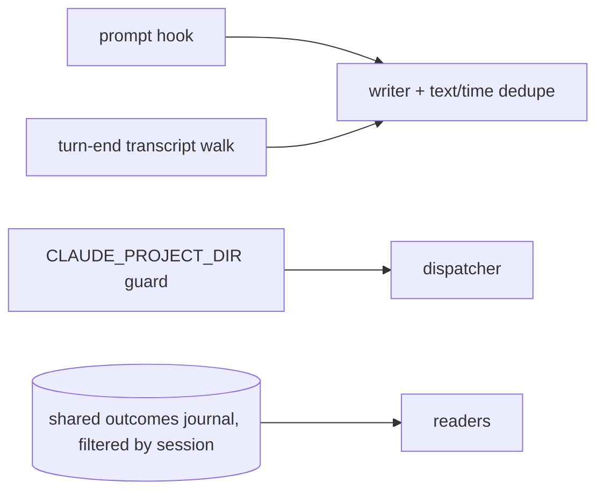
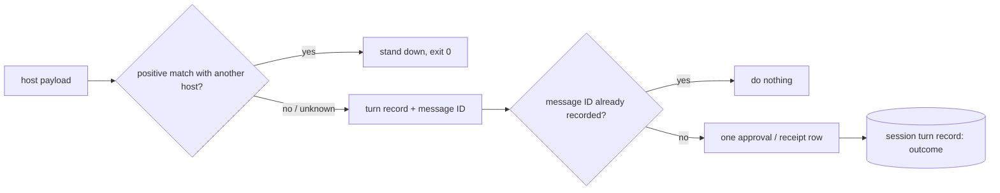
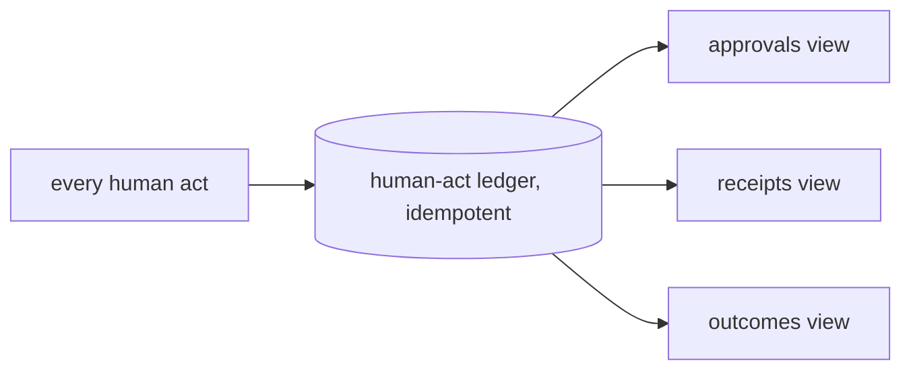

# Design Analysis: 202-beta4-1-ux-stabilization, Iteration 002

**Feature**: 202-beta4-1-ux-stabilization
**Iteration**: 002 (B4F-127, B4F-129, B4F-125 with B4F-128, B4F-130, B4F-131, candidate 3, candidate 7)
**Date**: 2026-10-17
**Status**: agreed with the maintainer, 2026-10-17 (DA-1 to DA-5, each with the maintainer's changes)

## Problem framing

Iteration 002's items share one shape: a single human act is recorded zero times or more than once. One typed
approval is recorded by two paths (B4F-127). One hook event fires once per host whose settings the running host reads
(B4F-129). One delegation covers one lens instead of the remaining ones (B4F-130). One answer in Copilot's question box
is recorded nowhere (B4F-131). One approval line is refused because of what follows it (B4F-125). The fix is the same
rule in each place: one human act, one record, keyed by the identity of the act, not by the path that saw it.

## What the code map found (read-only, 2026-10-17)

Abbreviations: HS = `scripts/internal/bootstrap/HandoverStore.ps1`, HAS = `scripts/internal/bootstrap/HumanAuthorityStore.ps1`,
WAS = `extensions/specrew-speckit/scripts/workshop-authority-store.ps1`, SG = `shared-governance.ps1`, DISP = the hook
dispatcher (twin copies in `scripts/internal/` and `extensions/specrew-speckit/scripts/`, identical today).

- **B4F-127.** Both paths call one router, `Invoke-SpecrewTypedAuthorityCapture` (HS:1169-1318): the prompt hook at
  HS:1417-1426 and the Stop's transcript walk at HS:1745-1764. The turn identity (`Get-SpecrewTypedTurnIdentity`,
  HAS:710-741) hashes host, source event, position, arrival and text. The source event is in the hash, so the two paths
  can never produce the same identity, and the exhausted-turn check (HAS:748-825) cannot see the first recording.
  Claude payloads carry a `prompt_id` that is the same on the prompt and on that prompt's Stop; nothing reads it. After a
  host-injected prompt the Stop carries the injected prompt's id, so the Stop path needs the transcript entry's `uuid`,
  which the parser drops. Copilot's prompt payload has no prompt id. Boundary verdicts are already protected, because
  they bind to the one pending stop (HS:1045-1051).
- **B4F-129.** `Invoke-RefocusHookDeployment` (`refocus-deploy-integration.ps1:111-180`), called by init and update,
  writes hook settings for every hook-capable host whose folder exists, not only the chosen host. Claude's command is
  guarded: it exits silently when `CLAUDE_PROJECT_DIR` is empty (`deploy-refocus-hooks.ps1:247`; the manifest comment
  at `hosts/claude/host.psd1:51-52` already names the Copilot case). Copilot 1.0.98 evidently sets that variable, so the
  guard passes. The dispatcher takes the host only from `-HostKind` (DISP:27) and has no payload-shape check. The
  payloads differ cleanly: Claude always sends `hook_event_name` and snake_case `session_id`; Copilot sends camelCase
  `sessionId` and never `hook_event_name` or `session_id` (all 14 Copilot fixtures). The receipt writer
  (WAS:838-989) appends without checking whether the receipt ID is already present.
- **B4F-125.** The guard is a line-count rule: `Test-SpecrewAuthorityMessageContinues` (HAS:296-313) refuses any message
  with content after its first line. It is called by the round, pause and allowance checks (HAS:529, 1221, 1818), with a
  copy for coverage deferral (SG:7921). An allowance reset writes no round approval (HAS:1832-1876).
- **B4F-128.** A discussion question is kept as the whole raw line and must appear exactly (turn-end-store.ps1:1219,
  1304); headings have the DRIFT-030 meaning match (:1255-1268).
- **B4F-130.** A "you decide" reply is a delegation for the open lens only (WAS:10-34, 941, 948), and
  `confirm-workshop-lens.ps1` takes one lens. Nothing tells the human that "the remaining lenses" was narrowed.
- **B4F-131.** The workshop skill already tells every host not to use a question tool (`design-workshop.md:55-62`,
  258-260). Copilot registers no tool-use hook, so its question-box path is never observed, and a dismissal fires no
  hook event.
- **Candidate 3.** The receipt-outcomes journal has one writer (WAS:471-507) and two readers: the dispatcher's
  recording disclosure (DISP:1236) and the conformance provider's latest refusal (:1379-1380).
- **Candidate 7.** `turn-message.md` is written by `declare-turn-end.ps1` (:151/160) and read by nothing; the message
  is stored inline in the turn record.

## Key Design Decision Points

- **DA-1 Host binding (B4F-129).** How a hook knows the event belongs to the host it was installed for.
- **DA-2 Message identity (B4F-127).** What identifies one human message on each host, so a second path recognises it.
- **DA-3 Approval form (B4F-125, B4F-131).** Which typed messages carry an approval when the phrase is not alone.
- **DA-4 Delegation scope (B4F-130).** What "you decide the remaining lenses" records.
- **DA-5 Receipt outcomes (candidate 3).** What replaces the receipt-outcomes journal for its two readers.

B4F-128 follows DRIFT-030's rule (a question line counts as present when its meaning matches), and candidate 7 is a
deletion; neither needs a design decision.

## Finding: Claude Code does not tag every paste (settled for DA-3, 2026-10-17)

The maintainer asked whether every paste arrives tagged. It does not. Across the 123 user messages in this feature's
Claude transcripts, 26 carry a `<pasted_content id="N">` pair. Every tagged paste is either multi-line (the smallest is
673 characters over 8 lines) or a single line of at least 1,016 characters. Single-line messages of 439 to 715 characters
arrive untagged, among them verdicts with instructions (`approved for clarify - ...`, `approved for plan - ...`,
`approved for review-signoff - ...`), and the maintainer's notes from the retro verdict say pasted verdicts of about 600
to 800 characters were recorded as typed. So a short paste is indistinguishable from typing in the text the hook receives.
The retro approval that was refused was a tagged single-line paste of 1,163 characters.

Consequence: the tag rule protects only long pastes. For a short paste, **safeguard 2 is the protection**: a quoted menu
is never an approval. One residual case stays open and is accepted as such: a short paste of a single approval line, with
no second verdict option, still counts, exactly as typing it would. The tests carry the size boundary observed here, and
not a guessed threshold.

## Alternatives

The governing choice is how iteration 002 enforces "one human act, one record". DA-1 to DA-5 are that choice applied to
each place; the options below are the three shapes it could take across all of them.

### Option A: Simplest — patch each symptom where it shows

**Approach**: fix each finding at its own symptom. Drop a second approval row when the text and time match a first one;
tighten Claude's environment guard; keep "you decide" per lens and add a hint; filter the receipt-outcomes journal by
session; keep the "alone only" rule and reword its refusal.
**Architectural pattern**: local guards at each writer and reader, no shared rule.
**Quality features considered**: lowest change cost. Weak on integrity (text-and-time matching is close to how B4F-127
happened), observability (an environment guard fails silently, as it did on Copilot) and parity (each writer keeps its own
rule).
**Effort estimate**: about 10 SP.
**Reversibility cost**: Low.
**Trade-offs**:

- (+) Smallest diff; no new field in any host binding.
- (−) Leaves the identity of a human act undefined, so the next path that observes a message double-records again.
- (−) Removes no store, the reason candidate 3 was taken.

**Design principle / why this matters**: cheaper because each fix is local, but every fix couples to the symptom, not to
the act it protects.

**Recommended for**: a hotfix with no iteration to absorb design work.

**Diagram**:

### Option B: Reasonable — one identity rule in the shared path (the five DA decisions)

**Approach**: every human act is keyed by what identifies it, and the rule lives once in the shared path. A message is
keyed by the host's own message ID (DA-2), an event belongs to the host whose declared fields it positively matches
(DA-1), a receipt ID is unique, a receipt outcome lives on the session's own turn record (DA-5), an approval is a typed
line outside any paired paste and never a quoted menu (DA-3), and a wide delegation covers each remaining lens (DA-4).
Host differences stay data in `host.psd1`.
**Architectural pattern**: declarative host bindings over one shared normalizer (iteration 001's DA-1), extended with an
idempotency key per human act.
**Quality features considered**: integrity first (one act, one record; nothing approved from a paste or a quoted menu);
parity (one rule, three bindings, proven by a replay test per host); observability (an unknown payload shape and an
unrecorded Copilot approval are logged and shown, never silent); simplicity (one store removed, none added).
**Effort estimate**: 17 SP (the iteration 002 plan, T016 to T024).
**Reversibility cost**: Low to Medium. The identity fields are additive; the retired journal is deleted on update, which
is the one step that cannot be undone, by the maintainer's choice.
**Trade-offs**:

- (+) Closes B4F-127 and B4F-129, the release gate, by the same mechanism.
- (+) Each rule is testable from recorded payloads through the shipped entry point.
- (−) Copilot keeps a single recording path until a recorded payload proves its turn end can match a message.
- (−) A short untagged paste of a single approval line still counts, as typing it would (accepted residual, see the
  finding above).

**Design principle / why this matters**: the identity of the act, not the path that saw it, decides whether a record is
new. That is what every iteration-002 finding lacked.

**Recommended for**: this iteration.

**Diagram**:

### Option C: By-the-book — one human-act ledger replacing the authority, receipt and outcome stores

**Approach**: a single append-only ledger of human acts with an idempotency key, from which approvals, receipts,
delegations and outcomes are all projected; the existing stores are migrated into it.
**Architectural pattern**: event sourcing with idempotent append.
**Quality features considered**: the strongest integrity and auditability; but it is the store redesign the spec puts in
beta5, it needs a migration of every existing ledger, and every reader changes at once.
**Effort estimate**: 30 SP or more.
**Reversibility cost**: High.
**Trade-offs**:

- (+) One place to reason about every human act.
- (−) Out of 202's scope by the spec; cannot fit the iteration; migration risk on the append-only ledger the project
  treats as untouchable.

**Design principle / why this matters**: right as a destination, premature as a fix for a release gate.

**Recommended for**: beta5, if the store simplification continues.

**Diagram**:

## Applicable Lenses

Selected by the applicability questionnaire (recorded in the feature's `lens-applicability.json`):

- **architecture-core**
  - Addressed: Option B Approach and Trade-offs - the identity rule lives once in the shared path and host differences
    stay data in `host.psd1` (DA-1); Option C is rejected as the store redesign the spec puts in beta5.
- **requirements-nfr**
  - Addressed: Option B Quality features - integrity first, proven by SC-010 (a replay per host, one approval gives one
    row) and SC-011 (the Copilot re-walk); the 17 SP effort against the 15.25 SP ruling is stated for the plan stop.
- **ui-ux**
  - Addressed: Option B Trade-offs and DA-3/DA-4 - an unrecorded act is reported in one visible line, a quoted menu's
    refusal names it, the narrow delegation names the wide phrase, and the reviewer choice is asked once at agenda.
- **observability-resilience**
  - Addressed: Option B Quality features against Option A - an unknown payload shape is handled and logged once (DA-1),
    and an unrecorded Copilot approval is journaled (DA-2), where Option A's environment guard fails silently.
- **security-compliance**
  - Addressed: Option B Trade-offs - authority integrity: no approval from a paired paste or a quoted menu (DA-3), no
    double-spend of one message (DA-2), and no host recording under another host's label (DA-1).
- **data-storage**
  - Addressed: Option B Approach against Options A and C - one store removed and none added (DA-5, deleted on update),
    receipt IDs unique; Option A keeps the shared journal, Option C adds a new ledger.
- **code-implementation**
  - Addressed: Option B Effort and the plan's tasks - the dispatcher twins edited together, red-first fixture tests from
    recorded payloads, one implementer working serially because T016, T017 and T022 share files.

## Crew Recommendation

**Recommended: Option B.**

Option B is the only shape that gives every finding in scope the same answer: the identity of the act decides whether a
record is new. It closes both release-gate findings with one mechanism, removes a store instead of adding one, and every
rule can be proven from recorded payloads. Option A leaves the identity undefined, so the next recording path repeats
B4F-127; Option C is the right destination but the wrong iteration.

## Co-Design Record

| Point | Decision | Date |
| --- | --- | --- |
| DA-1 | **Option A, with the maintainer's change.** Each host binding declares the payload fields only its host sends. A hook stands down (does nothing, exits 0) only when the payload positively matches another known host's fields. A payload that matches no known host is handled as today and logged once, so a host changing its payload shape can never switch governance off without a trace. The receipt store refuses a receipt ID it already holds. Note from the fixtures: Codex also sends `hook_event_name` and snake_case `session_id`, so the declared fields must tell all three apart (Claude `prompt_id`, Codex `turn_id`, Copilot camelCase `sessionId`), per event, proven against every recorded fixture. | 2026-10-17 |
| DA-2 | **Option A, with the maintainer's two conditions.** One human message has one key, the host's own message ID; the first path to record wins and the second does nothing; a spent approval from the same message is final. (1) On Claude both paths produce the same key: the turn-end path reads the same message-ID field (`prompt_id`) that the message hook receives, from the human-typed transcript entry, never that entry's own `uuid` (in the walk transcript every typed entry carries the field, and its `uuid` is a different value). Injected entries are skipped; the compaction summary reuses the `/compact` entry's ID. (2) On Copilot the message hook is the only recording path, and an approval-shaped typed message that hook did not record is reported in the journal and in one visible line, never dropped without a trace. Proof: a per-host replay test from recorded payloads, where one approval through both paths gives exactly one row. | 2026-10-17 |
| DA-3 | **Option A, with the maintainer's two safeguards.** On Claude, nothing inside a paste is an approval, and a phrase leading its own line outside every paste is, whatever surrounds it. Other hosts keep "the phrase alone", with a refusal that names the reason, until a recorded payload shows how they mark a paste. (1) A paste is marked only by an opening and a closing tag carrying the same ID, so a closing tag quoted inside a paste cannot make what follows it count as typed. (2) A message that carries more than one verdict option (for example a quoted packet menu with an approval line and a changes-needed line) is never an approval, and the refusal names it as a quoted menu. | 2026-10-17 |
| DA-4 | **Option A, with the maintainer's two changes.** A reply in one of a short list of exact wide forms ("the remaining lenses", "all remaining lenses") records one delegation per lens left on the agenda, all bound to that message's ID (DA-2), and the crew names the lenses covered in one line. "The rest" is not a wide form, because it can mean the rest of this lens. Lenses added later are not covered. (1) The narrow case is loud too: when a delegation covers only the open lens and other lenses are still pending, the confirmation line says so and names the phrase that covers the rest. (2) The reviewer choice stays outside delegation, because it spends the maintainer's quota. It is asked once, with the default named, preferably at agenda confirmation, so a later delegation runs through to the spec without a stop. A lens whose craft decisions are delegated and whose reviewer pick is confirmed closes with both receipts and asks nothing (the mix that cost the Claude walk its corrective exchange). Also answers B4F-136's reviewer-choice question. | 2026-10-17 |
| DA-5 | **Option A, with the maintainer's change: the journal is retired fully.** The receipt outcome is a field on the current turn's record in the session's own folder, and both readers (the same-turn disclosure and the Stop's latest-refusal check) read it there. In the same change the old writer stops writing the journal, and `specrew update` deletes `workshop-receipt-outcomes.jsonl` instead of leaving it on disk: agents read runtime files directly (in the walk, Claude and Copilot both opened `workshop-authority.jsonl` themselves), so a stale journal is a trap. Regression test for R5-5: two sessions in one project, and a refusal in one never shows up in the other. | 2026-10-17 |

## Human Decision

- **Chosen option**: modified-Option B (one identity rule in the shared path), with the maintainer's changes to each of
  DA-1 to DA-5 as recorded in the Co-Design Record above.
- **Reason**: given in the maintainer's typed replies, one decision per message: `DA-1: A, with one change ...`,
  `DA-2: A, with two conditions ...`, `DA-3: A, with two safeguards ...`, `DA-4: A, with two changes ...`,
  `DA-5: A, with one change ...` (2026-10-17).
- **Modifications**: positive-match stand-down with unknown shapes logged once (DA-1); the same message-ID field on both
  Claude paths and a visible report for an unrecorded Copilot approval (DA-2); paired paste tags and quoted-menu refusal
  (DA-3); exact wide forms, a loud narrow case, and the reviewer choice at agenda (DA-4); the journal deleted on update and
  an R5-5 test (DA-5).
- **Design-analysis draft commit**: `358f398a`.
- **Decision recorded in commit**: `17bf3269` (DA-1), `0e07fccc` (DA-2), `f08183e0` (DA-3), `24119ce3` (DA-4),
  `04628386` (DA-5).
- **Transcription disclosure**: agent-transcribed from the maintainer's typed co-design replies in the governing session.
  It records the design choice only; the plan itself is approved, or not, at the plan boundary with its own typed
  verdict.
