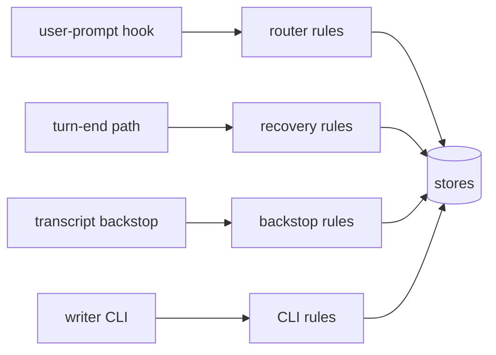
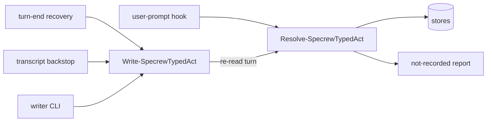
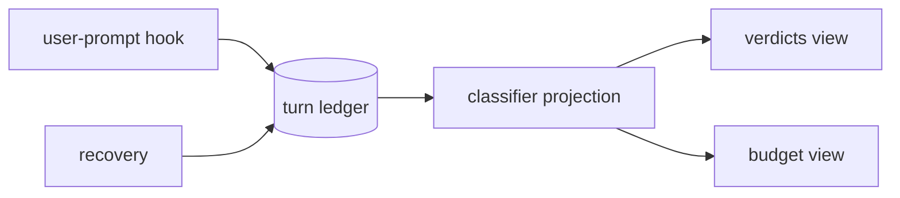

# Design Analysis: 203-beta5-stabilization, Iteration 001

**Feature**: 203-beta5-stabilization
**Iteration**: 001 (authority core: US1 review budget, US2 capture, US3 same-turn reports, plus FR-046)
**Date**: 2026-10-31
**Spec**: file:///C:/Dev/specrew-b4f-142/specs/203-beta5-stabilization/spec.md
**Status**: co-design agreed by the maintainer, 2026-10-31

## Problem Framing

Iteration 001 replaces per-round review approvals with a plan-stated budget that the before-implement verdict
snapshots, and makes every typed act (verdict, top-up, stop answer, workshop reply) recorded once, from the
human's own typed turn, the first time, or reported in the same turn when it is not. Today the same typed turn
is read by several paths (the user-prompt hook, the turn-end path, the transcript backstop, writer CLIs), each
with its own reading rules; that spread is the root of B4F-112, B4F-116/150, B4F-117, B4F-137/140 and B4F-151.
The review loop asks for a round approval per round and checks its cap after a round starts.

Constraints carried from the workshop: the existing layered hooks plus the campaign fact store, no new
subsystem; authority correctness outranks friction (b, a, c, d, f, e); stores keep ids and hashes; no script
or `!` approval path; the maintainer's clarify instruction that 203's changes reach the live hooks only after
an iteration's review.

## What the code map found (read-only, 2026-10-31)

- **Live engine resolution.** In this self-host repo the live providers load engine code from the project
  working tree first: the handover provider loads `scripts/internal/bootstrap` (HandoverStore,
  HumanAuthorityStore, ConversationCaptureAccessor) from `<project>/scripts/internal/bootstrap` before the dev
  override or the installed module (`.specify/.../specrew-handover-provider.ps1:82-87`); the navigator resolves
  `scripts/internal/continuous-co-review` from the project root first (`specrew-co-review-navigator-provider.ps1:60`);
  provider commands resolve from `.specify` then `scripts/internal` (`specrew-hook-dispatcher.ps1:955-965`). An
  uncommitted engine edit in this worktree judges the next approval.
- **Turn identity.** Claude `UserPromptSubmit` carries `prompt_id`; Codex carries `turn_id`; Copilot
  `userPromptSubmitted` carries no per-message id (it has `sessionId` and an epoch-ms `timestamp`); Copilot
  running Claude's hooks sends snake_case with an ISO `timestamp` and no `prompt_id`. Bindings declare
  `prompt_id` (`hosts/claude/host.psd1:86`) and `turn_id` (`hosts/codex/host.psd1:74`); Copilot declares none.
  Fixtures: `tests/fixtures/hook-payloads/<host>/`.
- **Pasted content.** Only Claude marks pastes (`<pasted_content id=N>`), and only larger ones (the smallest
  tagged was 673 chars / 8 lines). `Resolve-SpecrewApprovalForm` (`HumanAuthorityStore.ps1:372`) strips paired
  paste tags for Claude and falls back to size and one-line rules for other hosts. No Copilot or Codex paste
  evidence exists in the repo.
- **Visible line.** No adapter emits `systemMessage`. Claude's `additionalContext` reaches the model only; a
  Claude Stop block reason is shown to the human. Copilot replays a Stop block reason as a new user prompt.
  Codex never surfaced `stopReason` or `systemMessage` in the 198 characterization.
- **Compaction.** Claude's summary entry (`isCompactSummary`, type user) is already treated as not human
  (`ConversationCaptureAccessor.ps1:99-107`); no recorded fixture exists. Copilot and Codex: no evidence.
- **Review budget.** The grant is one slot per authorization (`review-campaign-orchestrator.ps1:1725-1745`);
  `Get-ReviewCampaignRoundBudgetState` reads `budget_total` from config and counts invoked rounds since the
  latest reset (line 675); the per-round approval is minted in `HumanAuthorityStore.ps1` (`approve-round`).
- **Narrow scope.** `specrew review --remediate narrow-scope --scope path:<p>` narrows the reviewer prompt only
  (not the files) and labels the run `partial` (`worktree-review-orchestrator.ps1:887`).
- **Token usage.** `Get-ReviewSafeUsageProjection` reads `runtimeResult.usage`, which only the fixture runtime
  fills; no harness port parses usage.

## Key Design Decision Points

1. **DA-1 Typed-act capture seam** (governing): where the one classifier lives and how the other paths use it.
2. **DA-2 Turn identity per host**: Claude `prompt_id`, Codex `turn_id`, and an explicit Copilot substitute.
3. **DA-3 Standalone-phrase rule per host**: how quoted, backticked and pasted phrases are excluded where the
   host does not mark pastes.
4. **DA-4 Visible line per host**: which channel carries the same-turn report and the closing line.
5. **DA-5 Budget declaration and snapshot**: where the plan states the budget, where the snapshot is taken, and
   where the ceiling lives.
6. **DA-6 Review loop**: reservation before invocation, pause facts as the only stop, infrastructure-failure cap.
7. **DA-7 Late-fix scoped round** (FR-013): how a round scoped to the changed files counts toward coverage.
8. **DA-8 Live engine pin**: how 203's engine changes stay out of the live hooks until an iteration's review.

Iteration 002 points (census sharding, claim release, journal flush, stop-reason conversions) are designed at
iteration 002's design analysis.

## Alternatives

The governing choice is DA-1, the capture seam: every other point lands on the act it produces. DA-2 to DA-8
each carry one recommended mechanism, listed after the options.

### Option A: Simplest — more branches in today's router

**Approach**: Keep the current paths (user-prompt router `Invoke-SpecrewTypedAuthority`, turn-end recovery,
transcript backstop, writer CLIs) and add the top-up and the stop answers as further branches of the router.
Each path gets the four FR-015 conditions added in place.
**Architectural pattern**: layered hooks, per-path rules.
**Quality features considered**: security-compliance (partially: rules duplicated per path); observability.
**Effort estimate**: 8 SP for the capture core.
**Reversibility cost**: Low.
**Trade-offs**:

- (+) Smallest diff; no change to how paths are wired.
- (−) Four readers keep four copies of the rules; the B4F-117 and B4F-140 classes recur when one copy drifts.
- (−) FR-022's re-derivation has no single function to call.

**Design principle / why this matters**: cheaper, but couples each path to its own copy of the authority rules.

**Recommended for**: a hotfix, not a release whose top measure is (b).

**Diagram**:



### Option B: Reasonable — one classifier, every path re-derives through it

**Approach**: One pure function, `Resolve-SpecrewTypedAct`, takes a turn record (identity, origin, text, host)
plus the pending state (waiting crossing, open pause, open workshop question) and returns exactly one act or
none with a reason. The user-prompt hook calls it once per typed turn and writes the act. Every other path
(turn-end recovery, transcript backstop, any writer CLI) calls one writer, `Write-SpecrewTypedAct -TurnIdentity`,
which re-reads that turn, re-runs the same classifier, and writes only the derived act, only if unrecorded.
The "not recorded" reporter consumes the classifier's reason. Stores stay the sinks.
**Architectural pattern**: layered hooks with a single shared engine (functional core, imperative shell).
**Quality features considered**: security-compliance (one mint origin, re-derivation), requirements-nfr (b, a,
c proven in one place), observability (one reason vocabulary), code-implementation (pure core, DTO in/out).
**Effort estimate**: 13 SP for the capture core.
**Reversibility cost**: Medium.
**Trade-offs**:

- (+) One rule set; FR-015, FR-018, FR-022 and FR-026 hold by construction.
- (+) The no-human-turn and non-approval phrase fixtures test one function plus the wiring.
- (−) Every path is rewired; the old per-path rule code is removed, which is the main risk.

**Design principle / why this matters**: authority rules live once, in a pure function every path must call.

**Recommended for**: this iteration.

**Diagram**:



### Option C: By-the-book — a typed-turn ledger with acts as projections

**Approach**: Every human turn is appended as an immutable turn fact (identity, hash, standalone flags, origin).
Acts are not written; they are computed as projections from the ledger by the classifier. Writer paths are
removed entirely; recovery appends a missed turn fact.
**Architectural pattern**: event-sourced turn log.
**Quality features considered**: all of B, plus full replay.
**Effort estimate**: 21 SP for the capture core, plus migrating every store reader.
**Reversibility cost**: High.
**Trade-offs**:

- (+) Strongest audit: every act is reproducible from turns.
- (−) A new subsystem, which architecture-core ruled out; every store reader changes.
- (−) Doubles the iteration's size.

**Design principle / why this matters**: premature for 203; the workshop bound "no new subsystem".

**Recommended for**: a later feature if B's audit proves insufficient.

**Diagram**:



### DA-2 to DA-8 (one recommended mechanism each)

- **DA-2 Turn identity.** Claude: `prompt_id` (payload) and `promptId` (transcript). Codex: `turn_id`. Copilot,
  and Copilot running Claude's hooks: the substitute identity is `sha256(session id + host timestamp + prompt
  text)`, from the payload only, with the binding declaring it explicitly. A turn without any identity mints
  nothing and is reported. **Co-design amendment:** Copilot also runs the Claude hooks, so one typed turn reaches
  the dispatcher twice (camelCase epoch-ms `timestamp` from Copilot's own hook, snake_case ISO `timestamp` from
  the Claude-hook firing). The stand-in identity MUST come out identical for both firings, or one approval
  records twice (the backstop double-record class): the timestamp is normalized to UTC epoch milliseconds and
  the session id to one form before hashing. The first work item captures both firings for one prompt in a
  scratch directory and asserts one identity. If the two firings do not carry the same instant, the identity
  drops the timestamp, and the plan brings the replacement (session id, prompt hash and a duplicate window) to
  the before-implement boundary.
- **DA-3 Standalone rule.** For all hosts, an approval phrase counts only when it starts the message (after
  whitespace), sits outside quotes and backticks, and the message is within today's size bound; Claude also
  strips paired paste tags first. Iteration 001's first work item captures a paste on Copilot and Codex in a
  scratch directory (never this worktree) and records whether either marks it; the rule is then confirmed or
  tightened per host before the capture work item lands.
- **DA-4 Visible line.** Claude: verify `systemMessage` in the first work item and use it for the same-turn
  report and the closing line. Copilot and Codex: no verified visible channel; the not-recorded report there
  is a stop, kept in the B5F-004 audit (FR-027), and the closing line gets a drift entry, not a block (FR-029).
- **DA-5 Budget.** The plan states the budget in a `## Review budget` section with a fenced block (`rounds`,
  `host_order`, `infra_failure_cap`). Plan sync validates it against the ceiling; the before-implement verdict
  capture snapshots it into a grant fact in the campaign store citing the verdict entry. The ceiling is the
  existing config value, renamed to a validation bound (`review.max_rounds_per_grant`), named in the refusal.
- **DA-6 Review loop.** The orchestrator reserves a round before invoking the reviewer, against
  `budget_total` from the grant (not config); pause facts (a)-(d) are the navigator's only stop source;
  `infra_failure_cap` consecutive infrastructure failures advance the host in the approved order.
- **DA-7 Late-fix round.** A crew-directed scope (`path:` list of the files the fix changed since the last
  clean round), labelled `scoped` rather than `partial`. Coverage counts as complete when a clean full round
  plus clean scoped rounds cover every file changed since that full round. **Co-design amendment:** the scope
  MUST restrict the files the reviewer RECEIVES, not only what its prompt asks it to look at, because the point
  of scoping is token cost. Today's narrow-scope path narrows the prompt only; the scoped target materializes
  the disposable review worktree with only the listed paths (a sparse checkout of the frozen target commit),
  and the run records the path list it received.
- **DA-8 Live engine pin.** The live hooks must not load engine code from this worktree. **Co-design
  amendment:** no checkout inside the worktree. A nested checkout under `.specrew/` is counted as source (a
  nested worktree tripped the coverage stop this week), and census selection and lint would pick up its
  `tests/` and `.md` files. Two placements compared:

  | | Checkout outside the worktree (user profile) | Installed module as the pin |
  | --- | --- | --- |
  | Where | `%USERPROFILE%\.specrew\live-engine\203-beta5-stabilization`, a detached `git worktree` at the last reviewed commit | `Documents\PowerShell\Modules\Specrew\<version>`, advanced by a local build install after sign-off |
  | Blast radius | this worktree only (selected through the hook launcher's existing `-ModulePath`, i.e. `SPECREW_MODULE_PATH`) | every project and worktree on the machine that loads the module, including other features' sessions |
  | Advance | `git -C <pin> checkout --detach <signed-off commit>` plus the `.specify` sync from the same commit | a local build and install (the `specrew-local-build` route) plus `specrew update` |
  | Exercises packaging | no | yes: FileList, module layout and update run for real |
  | Pre-203 features elsewhere | unaffected | would meet the budget model (a plan with no budget gets zero rounds) before 203 ships |
  | Resolution change needed | the self-host tree must yield to `SPECREW_MODULE_PATH` when it is set | the self-host tree must yield to the installed module |

  **Picked: the checkout outside the worktree.** Its effect is confined to this worktree, and it does not put
  a pre-release review model under other features' sessions. Packaging is still exercised by the census and the
  release dry run, as today. The resolution change (the self-host tree yields to an explicitly set
  `SPECREW_MODULE_PATH`) is the iteration's first change, reviewed and deployed on its own. After it, engine
  edits in this worktree are inert until the pin advances. The pin advances only after an iteration's review
  sign-off, together with the `.specify` sync from the same commit. Consequence: iteration 001's own review runs
  on today's per-round approvals; iteration 002's review is the first on the budget model.

## Crew Recommendation

Recommended: Option B, with the recommended mechanisms for DA-2 to DA-8. B is the only DA-1 choice that makes
measure (b) hold by construction without a new subsystem, and it gives FR-022's re-derivation one function to
call.

## Co-Design Record

Human-agreed: yes

**Co-design agreed by the maintainer, 2026-10-31, Claude session:** the component map accepted as drawn, Option B
accepted, DA-3 to DA-6 accepted as proposed, and DA-2, DA-7 and DA-8 amended, in one typed reply ending with
`move on`. The amendments are recorded in the DA entries above.

### Agreed component map

```text
 HOST BINDINGS (data)   hosts/<host>/host.psd1: identity field per host (DA-2), output shapes (DA-4)
        |
        v
 DISPATCHER             specrew-hook-dispatcher.ps1 -> turn record {identity, origin, text, host}
        |
        +--> HANDOVER PROVIDER (user-prompt + turn end)
        |       | calls once per typed turn            | recovery paths call
        |       v                                       v
        |    [Resolve-SpecrewTypedAct] <---re-read--- [Write-SpecrewTypedAct -TurnIdentity]
        |       | one act or none + reason
        |       +--> NOT-RECORDED REPORTER (same turn; visible line or justified stop)
        |       v
        |    ACT SINKS: boundary verdict ledger | budget-reset fact | stop-answer fact | workshop receipt
        |       | before-implement verdict
        |       v
        |    [BUDGET SNAPSHOT] plan "## Review budget" -> grant fact (budget_total, host order, infra cap)
        |
        +--> CONFORMANCE PROVIDER (Stop): checks the reply's decision parts only (FR-046)
        |
        +--> NAVIGATOR PROVIDER: stops only on pause facts (a)-(d)
                ^
 ORCHESTRATOR           reserve round BEFORE invoking reviewer; clean -> end; fix -> next round;
                        N infra failures -> next host; spent -> pause (a); late fix -> scoped round (DA-7)
        |
 LIVE ENGINE PIN        outside the worktree; live hooks load engine code from it via SPECREW_MODULE_PATH (DA-8)
```

### Component responsibilities

- **Host bindings**: declare each host's identity field and output shapes as data.
- **Dispatcher**: turns a host event into one turn record.
- **Resolve-SpecrewTypedAct** (new, pure): turn record plus pending state in; exactly one act or none with a
  reason out.
- **Write-SpecrewTypedAct** (new): the only writer for recovery paths; re-reads the cited turn and re-derives
  through the classifier.
- **Not-recorded reporter**: turns the classifier's reason into the same-turn report.
- **Act sinks**: the existing stores (verdict ledger, budget-reset fact, stop-answer fact, workshop receipts).
- **Budget snapshot**: at the before-implement verdict, copies the plan's budget into the grant fact.
- **Orchestrator**: runs the loop within the grant, reserving before invoking.
- **Navigator**: shows the four review stops, nothing else.
- **Conformance (Stop)**: verifies the reply itself for its decision parts.
- **Live engine pin**: keeps unreviewed engine code out of the live hooks.

### Agreed flows

- **Top-up**: budget spent → orchestrator writes pause (a) → navigator shows the stop → the human types
  `approved for allowance reset` → dispatcher → classifier routes it to a top-up → budget-reset fact (the
  human's text or no reason) → orchestrator reserves the next round → the reviewer runs.
- **Budget grant**: the human types `approved for before-implement` → classifier routes a boundary verdict →
  verdict ledger → budget snapshot reads the plan's `## Review budget`, validates it against the ceiling, and
  writes the grant fact citing the verdict entry.

## Human Decision

**Chosen Option**: Option B (one classifier, every path re-derives through it), with DA-2 to DA-8 as recorded
above, including the maintainer's amendments to DA-2, DA-7 and DA-8.
**Given**: 2026-10-31, by the maintainer, in one typed reply at the design-analysis co-design, ending with
`move on`. The component map was agreed as drawn.
**Human reason, modifications and instructions (verbatim in substance)**:

- DA-2: Copilot runs the Claude hooks as well as its own, so one typed turn reaches the dispatcher twice; the
  stand-in identity must come out identical for both firings, or one approval records twice. The first work
  item captures both firings for one prompt and asserts one identity.
- DA-7: the scoped round must restrict the files the reviewer receives, not only what it is asked to look at;
  the point of scoping was token cost.
- DA-8: no checkout inside the worktree (a nested checkout is counted as source, and census and lint would pick
  up its files); compare a checkout outside the worktree with the installed module as the pin, and pick one.
  The crew picked the checkout outside the worktree, with the comparison recorded under DA-8.

**Decision commit**: `130e88c7` (the commit that first recorded this Co-Design Record).
**Transcription disclosure**: this decision is agent-transcribed from the maintainer's typed co-design reply in
the governing session. It records the design choice only. The plan itself is approved, or not, at the plan
boundary with its own typed verdict.
