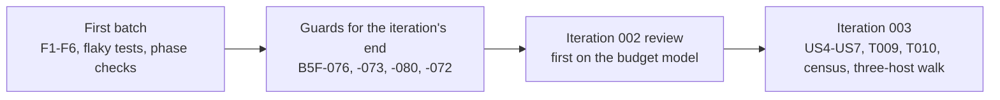
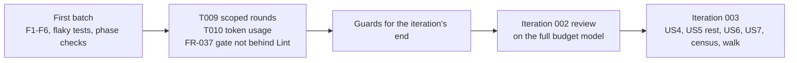
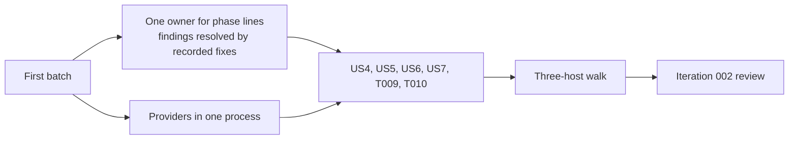

# Design Analysis: 203-beta5-stabilization, Iteration 002

**Feature**: 203-beta5-stabilization
**Iteration**: 002
**Date**: 2026-11-16
**Spec**: file:///C:/Dev/specrew-b4f-142/specs/203-beta5-stabilization/spec.md (US4 to US7, FR-012, FR-013, FR-028
to FR-040, FR-044)
**Inputs**: iteration 001's retro.md (Signals, Improvement Actions), review.md (Gap Ledger), drift-log.md, the decision
entry `f203-i001-gap-ledger-deferrals` in `.squad/decisions.md`, and docs/beta5-findings.md.

Sizes are story points (SP). The plan's effort model sized only iteration 001; every iteration 002 size below is the
crew's estimate (judgment), marked so, except where a task already carries a size in tasks.md.

## Problem Framing

Iteration 001 built the budget model, the typed-act capture and the pin. Its review ended with two open findings, and
the week showed that the lifecycle's own checks block an ordinary review end. The maintainer has already put six items
into iteration 002's first batch. The retro left eleven more for them to place. The spec's own iteration 2 scope (US4
to US7, T009, T010 and the three-host walk) is still to come.

Together that is about 44 SP against the 20 SP baseline the retro asks the crew to plan to. So the question for this
iteration is what it holds and in what order, and how the two large first-batch items are built: the sign-off gate
redesign and the hook cost.

## Fixed inputs: iteration 002's first batch

Placed by the maintainer (`.squad/decisions.md`, `f203-i001-gap-ledger-deferrals`; review.md's Gap Ledger). Not open
here; their sizes are the crew's estimates.

| # | Item | Source | Size |
| --- | --- | --- | --- |
| F1 | Round E `finding-cf1fe81e0398f883`: an approval with more than 2 MiB after it can be refused when a later record shares its prompt ID. Try the exact identity across every window first. A compaction summary is never taken as the cited turn (its real shape, DRIFT-083). | the partial sign-off, 2026-11-15 17:30 | 1.5 |
| F2 | Round E `finding-a537d3f72672e5f5`: a review-stop answer lost on the recovery path gets no report. The stop-answer fallback on that path, and a stop-answer case in `typed-act-writer` case 9b (DRIFT-084). | the same | 1.0 |
| F3 | The hook cost: about 19 s of hooks per turn (DRIFT-073). One git snapshot per hook run, one transcript tail read handed to the providers, the stores loaded once. | a condition the maintainer accepted, 2026-11-14 20:30, with 2026-11-15 01:19 | 5.0 |
| F4 | The sign-off gate: DRIFT-078 (a stop never covers a records commit made after it), DRIFT-091 (the ordinary review end takes one approval) and B5F-071 (no finding is ever marked resolved), as one design input. | 2026-11-15 01:19 and 19:02 | 4.0 |
| F5 | The missing retry test: a second top-up with no round between grants no extra window (the retry-idempotency hardening row). | 2026-11-16 02:13 | 0.5 |
| F6 | T014's live `stop the review here` on the advanced engine, reading its disposition's `authorization_ref`, at iteration 002's first review stop. A check, not a build. | 2026-11-15 20:57 | 0.25 |

**F4, the maintainer's requirement and the reviewer's elaboration, kept apart** (DRIFT-091):

- *The maintainer's words* (about 17:35 local on 2026-11-15): "Partial review is the more standard state, so approve
  it in this way looks a bit ood."
- *The reviewer session's elaboration*, accepted with "Yes for all" (19:02): the ordinary review end takes one
  approval, not two. The sign-off packet states the coverage: which findings were fixed and behind which failing-first
  test, which are open and accepted and where they go, and what changed since the last round, records and code apart.
  A separate typed override with a reason is kept for product code that no reviewer has read and no test covers.

Fixed first batch: **12.25 SP**.

## Items to place (proposals; the plan verdict decides)

Each item with no decision of the maintainer's behind it, by number, with the crew's proposed placement and one line
of reason. "First batch" means before the iteration's planned scope. "Later" means later in iteration 002. "Out" means
iteration 003 or a later feature.

| Item | What it is | Proposed | Reason | Size |
| --- | --- | --- | --- | --- |
| B5F-050 + B5F-059 | The sync's truth gate and the governance check need opposite phase lines at the sign-off (B5F-050) and at the retro (B5F-059) | First batch, with F4 | The retro's lesson 2: one owner for the phase checks; four deadlocks came from this | 1.5 |
| B5F-071 | No finding of a campaign is ever marked resolved | First batch, inside F4 | Already part of F4's design input (decision entry, part 3) | in F4 |
| B5F-075 | The sign-off coverage line counts a records change as a source file and states a round budget nobody set | First batch, with F4 | The same packet F4 rewrites | 0.5 |
| t008 lane time | `f203-i001-t008-suites` at 838 of 900 s on `da78b600` (DRIFT-087) | First batch, measure only | Retro lesson 5: time it against the suspect (round D finding 1's whole-transcript read) before any limit moves; the limit itself is the maintainer's question | 0.5 |
| Site 13 | `co-review-service.Tests.ps1:127-129` against production `co-review-service.ps1:216`, which runs `Stop-Process -Force` with no wait (B5F-051's census, site 13) | First batch | The most frequent CI failure across the three crews; a code fix behind a failing test | 1.0 |
| HookRenderDedupe | Its timing cases I3a and I4b failed on records-only pushes; the maintainer's rerun rule of 2026-11-16 02:56 | First batch, with site 13 | The rule ends for everyone when the fix lands | 1.0 |
| `empty-result-retry.Tests.ps1` | On the rerun exception since 2026-11-15 11:31 | First batch, with site 13 | The reviewer session placed it there; same class | 0.5 |
| B5F-077 | A tracked symbolic link into another machine's home folder (`.antigravitycli/...json`) | First batch, if the maintainer agrees to remove it | It caused DRIFT-081's first defect and aborted a dry run's file listing; removal is theirs | 0.25 |
| B5F-076 | A failed review preflight drops the engine's derived diagnosis (exit code, duration, timeout) | Later, before the iteration's first review round | Iteration 002's own review will hit a preflight failure sooner or later; 2,802 s were lost to it once | 1.0 |
| B5F-073 | The feature-closeout sync passed and recorded a crossing while a later iteration is planned | Later, before the iteration's closeout | It would let 203 itself be closed with work left | 1.0 |
| B5F-080 | The task writer changes the iteration status after the boundary that owns it | Later, before the last task is marked done | It recurs at every iteration's last task | 0.5 |
| B5F-072 | The old pin's partial capture re-spent a spent round approval | Later, one guard case only | Not seen on `da78b600`; a guard keeps it that way | 0.25 |
| B5F-078 | A waiting turn refused three times for a coverage decision it cannot make (field sighting) | Later, with US4 (FR-029) | US4 is the work on waiting turns and their closing line | 0.5 |
| B5F-079 | A stop answer with no stop waiting gets two texts, one false; the hook sends no `systemMessage` | Later, with US4 (FR-029, FR-030) | US4 is the visible-line and blocking-text work; T006's promise is checked there | 0.5 |
| B5F-074 | A red Lint skips the deterministic gate and the contract lane | With US5 (it is FR-037) | FR-037 already requires that the gate not depend on lint (202's B4F-158) | in US5 |
| Env-restore suites | Five suites restore an absent variable as empty (DRIFT-081) | Later | Unknown whether any is red with no `HOME`; check, fix any that are | 0.5 |
| Pester classifier | `run-suites` reads any line starting with `Describe` as a Pester suite (DRIFT-080) | Later | It now fails loudly, so it can wait | 0.5 |
| Rest of the census | B5F-051's 13 other timing sites | Out, unless capacity allows | B5F-051 proposes site 13 first, then the rest | 3.0 |
| T006's launcher half | The plain-text launcher refusals, undelivered live (DRIFT-046); the maintainer's "launcher: wait" (2026-11-16 03:13) | With the merge, or bundled into F3's push | F3 changes hook files and needs a full sweep anyway; a redeploy alone costs a 2 h sweep | 0 (bundled) |
| CI sightings | Windows `0xC0000142` (B5F-067) and the Pester-gallery install failure (DRIFT-094's own line) | Out, evidence only | Runner-side; no code of ours is known to cause them | 0 |
| B5F-083 | A scaffolded iteration cannot be pushed until its plan exists, so its first records wait for the plan boundary | First batch, with B5F-050 + B5F-059 | The same phase-line ownership problem; met while opening this iteration (2026-11-16) | in the B5F-050 row |
| B5F-081 | A fresh scaffold fails the governance lane on its own hardening-gate.md | Out: candidate for feature 206's list | A scaffold and validator defect, not this feature's capture or review work | 0 |
| B5F-082 | The scaffold's hardening-gate.md template fails markdownlint in its own text | Out: candidate for feature 206's list | Same | 0 |
| B5F-084 | The iteration scaffold writes `contracts/mechanical-findings.schema.json` outside the iteration folder, unannounced | Out: candidate for feature 206's list | Same; accepted as the scaffold's own file here | 0 |
| B5F-085 | The quality-profile resolver misreads this repository's stack again | Out: candidate for feature 206's list | Same; corrected by hand in this plan, as in iteration 001 | 0 |

## The iteration's own planned scope (spec)

Sizes are crew estimates except T009 and T010, which tasks.md sizes.

| Work | Requirements | Size |
| --- | --- | --- |
| US4: stops only with a decision; every wait says what to type; blocking text for humans; one-reply workshop confirmation; refusal standard | FR-028 to FR-032 | 5.0 |
| US5: census on every pull request, sharded and required; shard sizing; the selection check and B4F-119's seven suites; gate not behind lint (B5F-074); lint of the composed fragment and dot-directories | FR-034 to FR-038 | 5.0 |
| US6: a merged feature's claim is released, with a release record | FR-033 | 1.5 |
| US7: the journal flush rule and the Linux lock-wait measurement | FR-039, FR-040 | 2.0 |
| T009: the scoped late-fix round (DA-7) | FR-013 | 2.0 |
| T010: host-reported token usage | FR-012 | 1.5 |
| FR-044: the three-host walk (Claude, Copilot, Codex), manual with records | FR-044 | 2.0 |
| **Planned scope** | | **19.0** |

## When each fix becomes live

Two kinds of code run in this project, and a fix reaches them at different times (read from the code, 2026-11-16):

- **Run from the tree, so live on commit**: CI and every test; the boundary syncs, which the governed commands start
  from the project's own `.specify/extensions/specrew-speckit/scripts/sync-boundary-state.ps1` and which resolve no pin
  (iteration 001's DRIFT-078); the sign-off evidence gate and the sender check the sync runs (`signoff-gate-wiring.ps1`
  loads the tree's `HumanAuthorityStore.ps1`, `:171-192`); the governance check; the task writer; the verification
  plan's lanes (`.specrew/verification-plan.json` is the project's file).
- **Run from the pin, so live only when the pin advances**: every hook. The launcher runs the pin's dispatcher
  (`.claude/specrew-hook-launch.ps1:12-27`, the record in `.specrew/runtime/live-engine.json`), so the capture, the
  not-recorded reports and the Stop checks are the pin's. The review rounds and their stops run the pin's
  `scripts/specrew-review.ps1` (iteration 001's DRIFT-076, DRIFT-081).
- **What moves the pin**: `live-engine-pin.ps1 -Action Advance -Commit <sha>` checks only that the pinned copy is a clean
  commit (`:54-60`, `:120-124`). The rest is this feature's rule: a reviewed, signed-off tree, a full sweep first
  (DRIFT-057), and the maintainer's typed `advance the pin`. The pin is at `da78b600` and moves only on that line.

| Item | Where it runs | Live when |
| --- | --- | --- |
| F1 (exact identity before the message-ID fallback) | The sync's sender check (tree) and the hooks' and review launch's checks (pin) | The sync's check on commit; the rest at a pin advance |
| F2 (the recovery path's stop-answer report) | The Stop hook (pin) | Pin advance |
| F3 (the hook cost) | The hooks (pin) | Pin advance |
| F4 (the sign-off gate) | The gate, the phase checks and the coverage line run in the sync and the validator (tree); the stop's landing and the packet capture run from the pin | The gate and phase checks on commit; the stop and capture parts at a pin advance |
| F5 (the retry test) | A test (tree) | On commit |
| F6 (the live stop check) | A check of the pin's stop | Needs the advanced pin; a check, not a change |
| B5F-050, B5F-059, B5F-083 (phase lines) | The sync's truth gate and the validator (tree) | On commit |
| B5F-075 (the coverage line) | The sync's gate (tree) | On commit |
| Site 13 | Its test (tree); its production half, the wait after `Stop-Process`, runs in review rounds (pin) | The CI flake ends on commit; the production wait at a pin advance |
| HookRenderDedupe, empty-result-retry | Tests (tree) | On commit |
| The t008 lane | The verification plan (project file) | On commit |
| B5F-077 (the link) | The tree | On commit |
| B5F-076 (the preflight diagnosis) | The review orchestrator (pin) | Pin advance |
| B5F-073, B5F-080 (closeout sync, task writer) | Tree scripts | On commit |
| B5F-072 (old pin re-spend) | A guard test (tree) | On commit |

Two consequences:

1. **Until the pin moves, F2, F3 and the pin-side parts of F1 and F4 change nothing the maintainer sees**, iteration
   002's own review end included. The hook cost stays at about 19 s per turn all iteration.
2. **The tree-run gates go live unreviewed.** F4's gate and the phase-line checks judge iteration 002's own sign-off
   as soon as they are committed, before any review round has read them. This was true in iteration 001 as well: the
   sign-off sync ran the development tree's gate (DRIFT-078).

## Capacity

| Part | SP |
| --- | --- |
| Fixed first batch (F1 to F6) | 12.25 |
| Proposed first-batch additions (B5F-050 + B5F-059 + B5F-083, B5F-075, t008, site 13, HookRenderDedupe, empty-result-retry, B5F-077) | 5.25 |
| Proposed later items (B5F-076, B5F-073, B5F-080, B5F-072, B5F-078, B5F-079, env-restore, classifier) | 4.75 |
| The spec's planned scope | 19.0 |
| **All of it** | **41.25** |
| Rest of the census, if taken | 3.0 |
| Review rework buffer (see below) | 2.0 |

The baseline is 20 SP. Iteration 001 planned 28.5 and ran well over (retro calibration: keep the 20-point baseline and
plan to it). The retro also asks the plan to price review: about two rounds per authority task, and half a day for the
review end until F4 lands. So the work does not fit one iteration, and the decision is what moves out.

**The review allowance.** Iteration 001 took 13 single-task rounds and five iteration rounds (A to E); every round found
real defects. Feature 206 planned 20 of 20 and was 1.5 SP over after its first round. Feature 205 plans 7 SP plus a
2 SP buffer. This draft prices a **2.0 SP rework buffer** for fixes that review rounds find, as 205 does. Measured
evidence for the size: 206's 1.5 SP after one round; judgment for the rest.

| Option A shape | Work | Buffer | Total | Against 20 |
| --- | --- | --- | --- | --- |
| A as drafted | 20.25 | 0 | 20.25 | +0.25, no room for review findings |
| A with buffer | 20.25 | 2.0 | 22.25 | +2.25 |
| A-buffered, at the baseline | 18.0 | 2.0 | 20.0 | 0 |

**A-buffered** keeps the fixed batch (12.25), the first-batch additions (5.25) and B5F-080 (0.5), and moves out B5F-076
(1.0), B5F-073 (1.0) and B5F-072 (0.25) to the next iteration or the follow-up feature. The cost: a review preflight
failure in iteration 002 still tells the operator nothing (B5F-076). The feature-closeout sync can still pass with work
planned (B5F-073); that matters less if 203 merges after this iteration (see Option A's merge variant).

## Key Design Decision Points

1. **The iteration's shape**: which of the planned scope stays in iteration 002, and which moves to an iteration 003.
   The specify verdict asked for two iterations, with the three-host walk at the end of iteration 2, so a third
   iteration departs from it and is the maintainer's call.
2. **F4's design**: how the sign-off gate lets the ordinary review end take one approval, how findings are resolved,
   and who owns the phase lines (B5F-050, B5F-059).
3. **F3's design**: how far the hook cost is cut in one step, and whether T006's launcher half rides in the same push.
4. **The order inside the first batch**. Recommended:
   1. The three flaky tests (site 13, HookRenderDedupe, empty-result-retry), with F5 and B5F-077. They are cheap and
      live on commit, and each ends a rerun exception for all three crews at their next merge of this branch.
   2. F1 and F2, the open round E findings, each behind a failing test.
   3. F4 with the phase-line ownership (B5F-050, B5F-059, B5F-083) and B5F-075. They are one design, and their gate side
      goes live on commit, so it lands before the iteration's own review end rather than at it.
   4. F3 last. Its push needs the full sweep anyway, and it can carry T006's launcher half in the same sweep.
   5. F6 at the iteration's first review stop. The t008 measurement comes before any lane limit changes.

   Reason: the reviewer session's lean, which the crew shares. One change: F5 and B5F-077 ride in the first step,
   because they are test-only and file-only.
5. **An earlier pin advance**. Without one, F2, F3 and the pin-side parts of F1 and F4 serve no one until iteration
   002 ends (see "When each fix becomes live"). An advance in the middle of the iteration would let the hook cost and
   the one-approval review end serve the rest of it.
   - *What it needs*: today's rule asks for a reviewed, signed-off tree, a full sweep and the maintainer's typed line.
     A mid-iteration advance would rest on a review round that covers the first batch (a whole-tree round, since T009's
     scoped rounds are not built), a stop on that round, a full sweep, and the typed `advance the pin`. Iteration 001
     did this per task: T002 and T004 each had their own review and sign-off, and the pin then advanced (DRIFT-037).
   - *What it risks*: the maintainer's concern at the clarify verdict of 2026-10-31, that a half-built capture never
     judges their approvals. A round that reviews exactly what goes live limits it; the rest of iteration 002's work
     still reaches the hooks only at the next advance.
   - *Recommended*: one advance after the first batch's round, once F1, F2, F3 and F4 are fixed and that round stops
     clean or with only fail-closed findings. Then the iteration's own review end runs on the one-approval gate and the
     faster hooks. The pin moves only on the maintainer's typed line, whatever is chosen here.
6. **The merge shape**: an iteration 003 inside feature 203, or 203 merging after this iteration with the rest as a
   follow-up feature (Option A's merge variant).

## Alternatives

### Option A: Simplest — iteration 002 is the stabilization batch; the planned scope moves to iteration 003

**Approach**:

- Iteration 002 takes the fixed first batch, the proposed first-batch additions and the proposed later items that
  guard iteration 002's own end (B5F-076, B5F-073, B5F-080, B5F-072): 12.25 + 5.25 + 2.75 = **20.25 SP**.
- F4, built small: a human-accepted disposition for the reviewed digest authorizes a records-only difference on top of
  it (DRIFT-078's proposal). A finding is resolved by the run that reviews its fix, or by the human's stop for the
  open ones. The phase checks read the authority record's cursor, so `review.md` beside `plan.md` at `executing`, and
  `retro.md` beside `reviewing`, pass with a warning (B5F-050, B5F-059).
- F3, in one step: one git snapshot and one transcript tail read per hook run, passed to the providers; the providers
  stay separate processes. T006's launcher half is redeployed in the same push.
- Iteration 003 takes US4 to US7, T009, T010, B5F-078, B5F-079, the env-restore suites, the classifier and the three-host walk (about 21 SP; 24 with the rest of the census).

**Architectural pattern**: stabilize then extend. The existing layered hooks and campaign facts stay as they are; each
fix is local, behind a test written to fail first.

**Quality features considered**:

- *requirements-nfr*: measures b and a (nothing recorded that was not given; recorded the first time) are where F1 and
  F2 sit, the top of the agreed priority order.
- *architecture-core*: no new structure; F4 changes the gate's records-only rule and the phase checks' source.
- *security-compliance*: F1 and F2 fail closed today; their fixes keep every refusal and add none that allows more.
- *observability-resilience*: B5F-076 brings the derived diagnosis back to the operator.
- *devops-operations*: site 13, HookRenderDedupe and empty-result-retry end three rerun exceptions for all crews.
- *ui-ux*: F4 removes the second approval from the ordinary review end.
- *code-implementation*: inherited rules; no new dependency.

**Effort estimate**: 20.25 SP for iteration 002; about 21 SP for iteration 003 (24 with the rest of the census).

**Reversibility cost**: High reversibility. Each fix is local and has its own red-first test; the gate change is one
rule and one source of truth for the phase lines.

**Trade-offs**: the spec's iteration 2 scope and the three-host walk wait one more iteration, which departs from the
two iterations the specify verdict set. The gate side of F4 goes live for the sync on commit, so iteration 002's own
sign-off uses it unreviewed. But the hooks, the stops and the capture stay on the pin at `da78b600` until the pin
advances, which today is after the review sign-off. So unless the pin moves earlier, iteration 002 runs with today's
hook cost and today's capture all through, its own review end included (see "When each fix becomes live").

**Variant: 203 merges after this iteration.** The maintainer's goal is to merge 206, then 205, then 203 into main, and
features 205 and 206 run under rerun exceptions and a protected-file rule "until 203 merges". In this variant, 203
closes after iteration 002 and merges. The spec's remaining scope (US4 to US7, T009, T010, the three-host walk FR-044)
becomes a follow-up feature.

- *What it needs in the records*: the feature-closeout checks look at the working tree and the dashboard
  (`sync-boundary-state.ps1:1406-1443`, `validate-governance.ps1:2598-2630`); none checks that every requirement was
  delivered, and the feature-closeout sync even passed with iteration 002 planned (B5F-073). So the move must be stated
  in the records themselves: a spec amendment that moves US4 to US7 and their requirements to the follow-up feature,
  and a decision entry that names the maintainer and quotes their words. The traceability check (every requirement has
  a task) must then read the moved requirements as moved, not as gaps.
- *The three-host walk*: FR-044 (spec.md:435) is the manual walk on Claude, Copilot and Codex, and the specify verdict
  put it "at the end of iteration 2". Iteration 001's capture changes were checked live on Claude only (T014); the
  hardening row lists "the Copilot and Codex replays" as not covered. Merging without the walk puts capture code on main
  that was never checked live on Copilot or Codex. A short walk of the capture cases only, on Copilot and Codex, before
  the merge closes most of that gap at about 1 SP. That is a judgment, not a measurement.
- *What main gains*: the reviewed capture, sender and review-loop code of iteration 001 and the stabilization batch.
  The rerun exceptions end for 205 and 206, and so does the protected-file rule tied to 203. The other crews stop
  running against a branch that moves under them.
- *Cost*: the follow-up feature starts with its own specify and plan stops, a few hours of the maintainer's time. The
  spec's two-iteration shape becomes two features.

**Diagram**:

### Option B: Reasonable — the stabilization batch plus the budget-model tasks; the rest moves to iteration 003

**Approach**:

- As Option A, plus T009 (scoped rounds) and T010 (token usage), so iteration 002's own review uses the budget model
  as designed, and FR-037 (the gate runs whatever Lint says, B5F-074) from US5, because it is small and every crew
  meets it: 20.25 + 2.0 + 1.5 + 0.5 = **24.25 SP**.
- F4 as in Option A, but a finding is resolved only by a recorded fix that names it (the fix commit cites the finding
  ID and the test committed red first); the sign-off packet lists each finding with its fix and test, as DRIFT-091
  asks.
- F3 as in Option A.
- Iteration 003 takes US4, the rest of US5, US6, US7, B5F-078, B5F-079, the env-restore suites, the classifier and the three-host walk (about 17 SP; 20 with the rest of the census).

**Architectural pattern**: stabilize then extend, with the review cycle completed first. The review engine gets the
two tasks it was designed with; everything else stays as in Option A.

**Quality features considered**:

- *requirements-nfr*: measure f (review costs at most sign-off plus top-ups) is first measurable here, with scoped
  rounds and token counts.
- *architecture-core*: finding resolution becomes an explicit record tied to a fix, not an inference.
- *security-compliance*: resolution by a recorded fix keeps the human's stop as the only way to accept an open finding.
- *observability-resilience*: token usage per round and at sign-off.
- *devops-operations*: FR-037 ends the skipped-gate case B5F-074 records.
- *ui-ux*: the sign-off packet lists each finding's fix and test.
- *code-implementation*: inherited rules; no new dependency.

**Effort estimate**: 24.25 SP for iteration 002 (4.25 over the baseline); about 17 SP for iteration 003 (20 with the rest of the census).

**Reversibility cost**: High. As Option A; T009 and T010 are additive.

**Trade-offs**: 4.25 SP over the baseline, the same shape of overcommit the retro warns about, though smaller than
iteration 001's. It still departs from the two-iteration plan.

**Diagram**:

### Option C: By-the-book — everything in iteration 002, as the spec planned, with the first batch ahead

**Approach**:

- The first batch, every proposed item and the spec's whole iteration 2 scope, ending with the three-host walk:
  **41.25 SP**, about twice the baseline.
- F4 by the book: one lifecycle state owner. The phase lines in `plan.md` and `state.md` are written only by the
  boundary syncs and the verdict capture, and every check reads them through one function, so no two checks can want
  opposite lines. Findings resolve through a recorded fix, as in Option B.
- F3 by the book: the providers run in one process with the stores loaded once (DRIFT-073's estimate: the Stop hook
  from about 14 s to about 5 s).

**Architectural pattern**: one owner per lifecycle fact. The phase lines and finding states each have a single
writer and a single reader function; the hook providers share one process.

**Quality features considered**:

- *requirements-nfr*: every measure (a to f) is addressed in one iteration, and the walk proves them on three hosts.
- *architecture-core*: the strongest fix for the deadlock class, at the cost of touching every check that reads a
  phase line.
- *security-compliance*: one writer for the phase lines narrows who can move the lifecycle.
- *observability-resilience*: the full hook-cost cut.
- *devops-operations*: the whole CI rider (US5) lands.
- *ui-ux*: the whole US4 lands.
- *code-implementation*: inherited rules; no new dependency; the largest change set of the three.

**Effort estimate**: 41.25 SP (21.25 over the baseline).

**Reversibility cost**: Low to medium. The phase-line owner and the single-process providers touch many callers; a
revert is large.

**Trade-offs**: twice the baseline, against the retro's calibration. The review of so large a change set is the kind
that took 18 rounds in iteration 001.

**Diagram**:

## Applicable Lenses

The lenses the intake workshop selected (`lens-applicability.json`), for this iteration's change.

- **architecture-core** - `extensions/specrew-speckit/knowledge/design-lenses/architecture-core.md`
  - Decision points: where review authority lives; one capture; what the stop check decides.
  - Addressed:
    - F4 changes the sign-off gate's records-only rule and the source of the phase lines; Options A to C size it.
    - F3 changes how the hook providers share their inputs; Option C goes to one process.
- **requirements-nfr** - `extensions/specrew-speckit/knowledge/design-lenses/requirements-nfr.md`
  - Decision points: measure priority b, a, c, d, f, e; how each is proven.
  - Addressed:
    - F1 and F2 serve measures b and a, the top of the priority order; each lands behind a test written to fail first.
    - Measure f is first measurable with T009 and T010 (Options B and C); the three-host walk (FR-044) proves the rest.
- **ui-ux** - `extensions/specrew-speckit/knowledge/design-lenses/ui-ux.md`
  - Decision points: stop layout, sendable phrases, closing line, blocking text for humans.
  - Addressed:
    - F4 removes the ordinary review end's second approval (DRIFT-091).
    - B5F-078 and B5F-079 go with US4, the closing-line and visible-line work (Options A and B move US4 to iteration
      003).
- **security-compliance** - `extensions/specrew-speckit/knowledge/design-lenses/security-compliance.md`
  - Decision points: one mint origin; recovery paths; the audit trail.
  - Addressed:
    - F1 keeps a compaction summary from ever standing in for the cited turn; F2 reports a lost answer on the recovery
      path. Both fail closed today and stay closed.
    - B5F-072's guard keeps a capture from touching a spent approval.
- **devops-operations** - `extensions/specrew-speckit/knowledge/design-lenses/devops-operations.md`
  - Decision points: the census in PR CI; lint no longer gating the tests.
  - Addressed:
    - Site 13, HookRenderDedupe and empty-result-retry end three rerun exceptions; B5F-074 is FR-037 (Option B takes it
      early).
    - US5 as a whole moves to iteration 003 under Options A and B.
- **observability-resilience** - `extensions/specrew-speckit/knowledge/design-lenses/observability-resilience.md`
  - Decision points: refusals that say what was looked for; token usage.
  - Addressed:
    - B5F-076 brings the preflight's derived diagnosis to the operator; T010 shows token usage (Options B and C).
    - US7's journal flush rule moves to iteration 003 under Options A and B.
- **code-implementation** - `extensions/specrew-speckit/knowledge/design-lenses/code-implementation.md`
  - Decision points: inherited rules; dependencies; reviewer.
  - Addressed:
    - Inherited rules, no new dependency, reviewer codex; every fix red first, one bug per fix commit.

*Not selected (intake workshop, with reasons in `lens-applicability.json`): component-design, data-storage,
integration-api.*

## Crew Recommendation

**Recommended: Option A.** It fits the 20 SP baseline (20.25), which the retro asks for after iteration 001 ran well
over. It closes every item the maintainer already placed and the flaky tests that slow all three crews, and it guards
iteration 002's own end against the deadlocks this feature met. Option B adds the budget-model tasks at 4.25 SP over
the baseline. Option C is twice the baseline. Both A and B need the maintainer's word on what follows iteration 002,
since the specify verdict set two iterations.

Within A, the crew recommends **A-buffered** (20.0 SP with a 2.0 SP review buffer), because every review round of
iteration 001 found real defects. It also recommends **the merge variant**: 203 merges after iteration 002, with a short
Copilot and Codex capture walk before the merge, and the rest becomes a follow-up feature. That ends the other crews'
exceptions soonest, and main gets reviewed code it does not have today. Both are recommendations; the maintainer
decides.

## Open decision points for the maintainer (each answerable in one line)

1. The iteration's shape: "Option A", "Option B" or "Option C".
2. Within A, the buffer: "A-buffered" (recommended; B5F-076, -073 and -072 move out) or "A as drafted".
3. After iteration 002: "merge, then a follow-up feature" (recommended, with a short Copilot and Codex capture walk
   first) or "iteration 003 inside 203".
4. The first-batch order: "order as recommended" (flaky tests, F5 and B5F-077; then F1, F2; then F4 with the phase
   lines; F3 last) or another order.
5. An earlier pin advance: "advance after the first batch's round" (recommended) or "advance at the iteration's end".
6. B5F-077, the tracked link into another machine's home folder: "remove it" or "keep it".
7. The t008 lane's 900 s limit, after the measurement: "measure first" (recommended) or a new limit.
8. T006's launcher half: "with the merge" or "with F3's push" (recommended: F3's push shares its sweep).
9. The rest of B5F-051's census (13 timing sites, about 3 SP): "next iteration or follow-up feature" or "this iteration
   if capacity allows".

## Human Decision

- **Decision verdict**: accepted as recommended, all nine points
- **Chosen option**: Option A, A-buffered, with the merge variant
- **Given**: 2026-11-16 11:34 local (UTC+2), by the maintainer, typed to the reviewer session specrewreviewer-98 and
  relayed to this crew under the wider delegation. Their words: "OK for all". The three words carry no content of
  their own; they answered these two lines, which the reviewer session had put to them to accept or change (quoted as
  shown to them):
  - "203: A, A-buffered, merge then follow-up, order as recommended, advance after the first batch, remove the link,
    measure first, launcher with F3, census later"
  - "203 rerun: yes"
- **The nine points, in this analysis's order**:
  1. Option A.
  2. A-buffered: 18.0 SP of work and a 2.0 SP review buffer; B5F-076, B5F-073 and B5F-072 move out.
  3. Merge, then a follow-up feature: 203 closes after iteration 002 and merges; US4 to US7, T009, T010 and the
     three-host walk (FR-044) move to a follow-up feature. This needs a spec amendment and a decision entry quoting
     the maintainer, and the short Copilot and Codex capture walk (about 1 SP) before the merge.
  4. The first-batch order as recommended (Key Design Decision Point 4).
  5. The pin advance after the first batch's round. This places the advance in the plan only; the advance itself still
     needs the maintainer's typed `advance the pin` at that time.
  6. B5F-077: remove the tracked link.
  7. The t008 lane: measure first; no limit changes before the measurement.
  8. T006's launcher half travels with F3's push. This refines "launcher: wait" (2026-11-16 03:13); nothing is
     redeployed now.
  9. The rest of B5F-051's census: later, in the follow-up feature.
- **"203 rerun: yes"**: on 203's own pushes of records only, a sole CI failure of site 13
  (`co-review-service.Tests.ps1:129`) or of `empty-result-retry.Tests.ps1` may be rerun once without asking; the
  sighting is recorded; a second failure stops. No exception on a push that touches code. HookRenderDedupe stays as
  ruled on 2026-11-16 02:56.
- **Reason**: the crew's recommendation (Crew Recommendation above), accepted without change.
- **Decision commit**: this section's commit.
- **Transcription disclosure**: agent-transcribed from the reviewer session's relay, which quotes the maintainer's
  words and time. It records the design choice only. It is not an approval: the plan is approved, or not, at the plan
  boundary with the maintainer's own typed verdict.

### Scope after the merge shape (2026-11-16 11:49 local)

The merge shape added the Copilot and Codex capture walk (1.0 SP), the per-suite time limit and step-level
`timeout-minutes` for the deterministic suites (0.5 SP, from a hang on feature 206's push, iteration 002 DRIFT-005)
and the spec amendment (0.25 SP). The maintainer chose option 1: "option 1 it is", typed to the reviewer session at
11:49 local and relayed, answering "B5F-080 out, full 2 SP buffer". The task rows total 19.25 of 20 SP and the 2.0 SP
review buffer is stated in the plan's text, so the stated total is 21.25 SP. B5F-080 moves to the follow-up feature.
Decision entry `f203-i002-scope-option-1`; drift log DRIFT-007.

### Main merged in before the review (2026-11-16 12:22 local)

Feature 206's T034 (`3a3ba803`) already fixes the governance-check half of B5F-050 and B5F-059, and 206 reaches main
first. The maintainer chose option 1: "203: 1", typed to the reviewer session at 12:22 local and relayed, answering
"merge main into 203 before 203's review". T023 shrinks to 0.75 SP and relies on 206's fix; T030 (1.5 SP, judgment)
merges main into 203 before the campaign when 206 is on main, with the merge after closeout as the fallback. Task rows
20.0 of 20, a stated 22.0 SP with the buffer. Decision entry `f203-i002-merge-main-before-review`; drift log DRIFT-011.
