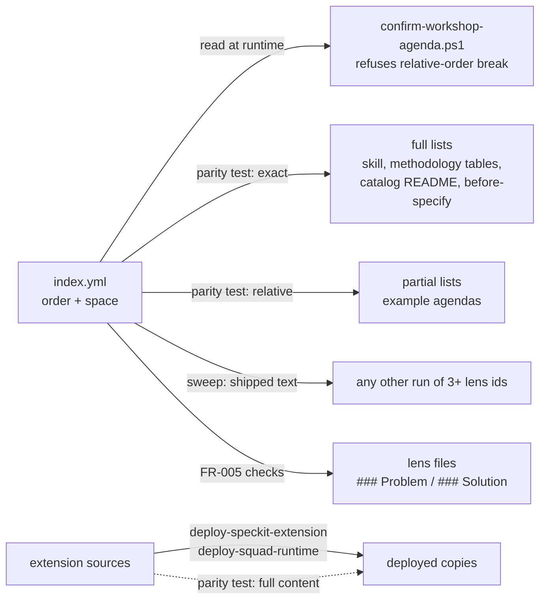
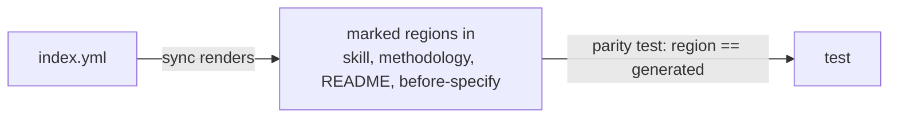

# Design Analysis — Feature 205 / Iteration 001

**Feature**: 205-workshop-lens-order
**Iteration**: 001 (proposal 220 iteration 1: single lens order, space tagging, parity proof, FR-013 migration)
**Date**: 2026-11-10
**Spec**: file:///C:/Dev/specrew-220-workshop-lens-order/specs/205-workshop-lens-order/spec.md
**Workshop records**: file:///C:/Dev/specrew-220-workshop-lens-order/specs/205-workshop-lens-order/workshop/

## Problem Framing

The design workshop asks structural questions (decomposition, building blocks, volatility) before the quality
attributes and constraints that should drive them. The lens order is defined in five places that disagree: the
workshop skill, `index.yml`, the methodology, the before-specify command, and each feature's own agenda. Nothing
detects that drift. This iteration makes `index.yml` the one order and tags every lens question by space (problem
or solution). It proves both mechanically, so neither can drift again. Agendas that are already confirmed are
left untouched.

## Key Design Decision Points

All of these were settled with the maintainer in the intake workshop. They are recorded here so the plan has one
place to read them:

1. **The single-pass whole-lens order** (architecture-core decision 1): option A, problem-first, with the problem
   section asked first inside every lens.
2. **How consumers get the order** (architecture-core decision 2): the agenda writer reads `index.yml` at
   runtime, and the prose lists stay where they are and are checked by the parity test.
3. **The space tag and section shape** (data-storage): `space: problem | solution | both` in `index.yml`, with
   list position as the order. The lens files get `### Problem questions` and `### Solution questions` inside
   `## Design Decision Points`.
4. **The parity proof** (requirements-nfr, plus the architecture-core correction): full lists must match exactly,
   partial lists must keep relative order, a shipped-text sweep covers everything else, and deployed copies must
   equal their source. Every mismatch is reported in one run.
5. **Copy refresh and CI** (devops-operations): the failure message names the two project-only deploy scripts,
   and the test runs as a named `specrew-ci.yml` step.

## Alternatives

The maintainer directed that this stop record only the option already chosen. The Reasonable block below is
recorded because the gate requires it. It is the alternative the maintainer considered and rejected at
architecture-core, and it is **not an open choice**.

### Option A: Simplest — index.yml as the one order; prose lists kept and checked by the parity test (CHOSEN in the workshop)

**Approach**:

- `index.yml` gains `space` per lens, and its list order becomes problem-first (option A).
- The lens files gain the two `###` sub-headings.
- The skill, the methodology, the before-specify command and the catalog README keep their lens lists, rewritten
  to the new order.
- The skill states that `index.yml` wins on any disagreement, and that a confirmed agenda keeps the order it was
  confirmed in.
- `confirm-workshop-agenda.ps1` refuses a new agenda whose selected lenses break `index.yml`'s relative order.
- One new script-style test, `tests/unit/lens-order-parity.tests.ps1`, checks:
  - full lists for exact order and membership
  - partial lists for relative order
  - a sweep of shipped text for any other run of three or more lens ids, with the exemption list
  - deployed copies against their source
  - FR-005 a/b/c
  - the `Get-SpecrewLensDecisionPoints` extractor
- `workshop-agenda-confirmation.tests.ps1` gains the refusal case and the FR-013 resume case.

**Architectural pattern**: one data source, read at runtime by code and checked against by text. Detection
replaces generation, with no new machinery in the sync.

**Quality features considered**:

- *requirements-nfr*: every requirement is proven mechanically: FR-001 parity, FR-005 tagging, and the extractor
  count formula (SC-002). Failures are reported in full, with the fix for each.
- *architecture-core*: problem facts land before structure. The known gap (mixed lenses ask their solution
  questions early) is closed by iteration 3's two-pass split.
- *devops-operations*: deployed copies are refreshed only by the two project-only deploy scripts, never by
  `specrew-update.ps1` in this worktree.
- *code-implementation*: no new dependency, since `Read-IntakeYaml` was verified to parse `space`. The work is
  test-first.

**Effort estimate**: ~10-15 SP (proposal 220's iteration 1 estimate).

**Reversibility cost**: High reversibility. It is data and text edits, one additive check in the agenda writer,
and one test, so a revert restores the old order.

**Trade-offs**:

- The skill stays self-contained: one load gives the agent the order.
- Hand-written lists can still drift, but the test catches them in CI with the exact fix.
- The sweep needs an exemption list, which is expected to be close to empty and is shown to the maintainer.

**Diagram**:



### Option B: Reasonable — generate the prose lists from index.yml during the sync (CONSIDERED AND REJECTED at architecture-core)

**Approach**: Each prose surface gets a marked region. The sync (the deploy scripts) writes the lens list into
that region from `index.yml`, so no list is hand-written. The parity test then only checks that each region
matches its generated form.

**Architectural pattern**: generation instead of detection. `index.yml` is rendered into the documents.

**Quality features considered**:

- *architecture-core*: lists cannot drift by hand. However, the agent reading the skill mid-workshop still sees
  whatever was last generated, so the runtime truth is unchanged.
- *devops-operations*: this adds generation machinery to the deploy scripts. Those scripts already restamp
  `.squad` files, so more writes widen that surface.

**Effort estimate**: ~15-20 SP.

**Reversibility cost**: Medium. Every surface carries generator markers, and the sync grows a rendering step.

**Trade-offs**:

- **Rejected by the maintainer at architecture-core (typed reply, 2026-11-10).** It adds generation machinery to
  the sync for no gain over a test that catches every disagreement with the exact fix.
- Option A keeps the fewest moving parts and leaves the skill self-contained.

**Diagram**:



**By-the-book**: not meaningfully distinct for this iteration. The by-the-book shape is the full proposal 220: a
two-pass split, problem sections at intake and solution sections at design-analysis, plus the back-check and
sweeps. The maintainer assigned all of that to iteration 3, after feature 203 merges.

## Co-Design Record

The component map below was agreed in the architecture-core lens. The maintainer's typed reply on 2026-11-10
confirmed "no new structure" and the consumption model, with the full-list correction.

**Component-to-responsibility map** (layered by role; no new component):

```text
Data          index.yml                         — the one lens order (list position) + space per lens
Text          lens files (11)                   — questions tagged under ### Problem / ### Solution questions
              skill, methodology, before-specify,
              catalog README                    — prose lists in index.yml order (full lists)
Code          confirm-workshop-agenda.ps1       — refuses a new agenda that breaks index.yml's relative order
              Get-SpecrewLensDecisionPoints     — unchanged; must keep returning every tagged point
Proof         tests/unit/lens-order-parity.tests.ps1
                                                 — FR-001 parity + sweep + copies, FR-005 a/b/c, extractor
              workshop-agenda-confirmation.tests.ps1
                                                 — refusal case + FR-013 old-agenda resume
Delivery      deploy-speckit-extension.ps1,
              deploy-squad-runtime.ps1          — refresh the deployed copies (project-only)
              specrew-ci.yml                    — named steps for the new/extended + covering tests
```

**Agreed flow** (a new feature's agenda):

```text
crew builds agenda JSON -> confirm-workshop-agenda.ps1 reads index.yml
  -> selected lenses in index.yml relative order?  yes -> render / persist agenda
                                                    no  -> refusal names out-of-order lenses + index.yml order, never reorders
confirmed agenda (before or after release) -> lenses close in its own order; never re-checked (FR-013)
```

**Agreed flow** (a maintainer edits the order):

```text
edit index.yml -> parity test -> every full list, partial list, sweep hit and stale copy reported in one run
  -> fix each surface; for copies run the two deploy scripts -> test green -> CI named step green
```

Human-agreed: yes (architecture-core lens, typed reply 2026-11-10, receipt aed97a1fee09292d59aae144f2f7cb2d7bc4ccad2079ba82d3c9abffc6926cb3)

## Crew Recommendation

**Recommended: Option A.** It is the option the maintainer chose in the workshop, and the one this stop records.

## Human Decision

- **Decision verdict**: approved for plan with Option A
- **Chosen option**: Option A
- **Reason**: Option A is the workshop's choice (architecture-core, 2026-11-10). `index.yml` is the one order, read
  at runtime by the agenda writer, and the prose lists are kept and checked by the parity test. That has the
  fewest moving parts, and the skill stays self-contained. Generate-during-sync was rejected at architecture-core
  because it adds generation machinery to the sync for no gain over a test that catches every disagreement with
  the exact fix.
- **Modifications**: none to the design. The maintainer's notes for plan.md (2026-11-10):
  1. define the sweep's "run of three or more lens ids" precisely, with matching and non-matching examples
  2. cover every FR, including FR-017, FR-020, FR-021 and FR-022
  3. record the quality resolver's node/react misread in the drift log, as a recurrence of the one recorded at
     feature 203's plan verdict (2026-10-31)
- **Verdict given**: typed by the maintainer on 2026-11-10.
- **Design-analysis draft commit**: `839ce7c9`
