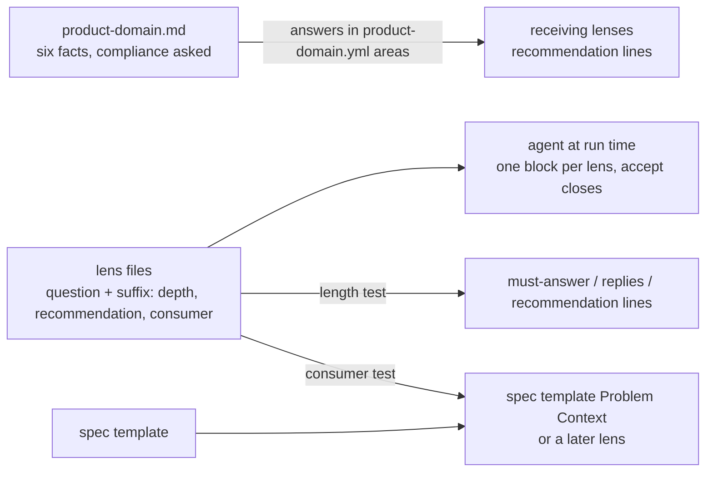
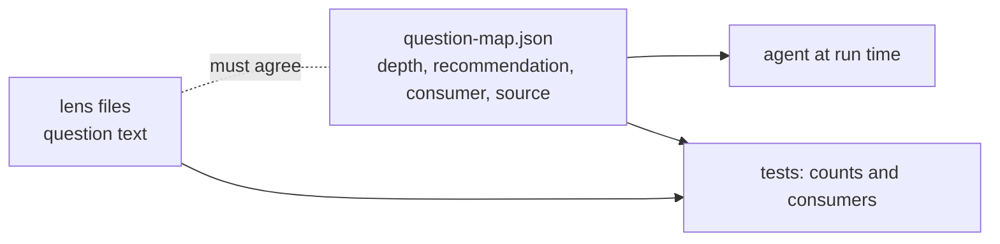
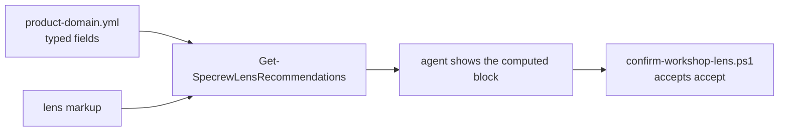

# Design Analysis — Feature 205 / Iteration 002

**Feature**: 205-workshop-lens-order
**Iteration**: 002 (Amendment A1: problem-space completeness)
**Date**: 2026-11-13
**Spec**: file:///C:/Dev/specrew-220-workshop-lens-order/specs/205-workshop-lens-order/spec.md (FR-023 to FR-031)
**Workshop record**: file:///C:/Dev/specrew-220-workshop-lens-order/specs/205-workshop-lens-order/workshop/iteration-002-problem-space.md

## Problem Framing

Iteration 001 found problem-side questions that later lenses need and nobody asks. The iteration 002 workshop settled
the shape: no new lens. product-domain covers six cross-cutting facts and hands them forward as later lenses'
recommended answers. Twelve lens-specific questions go inside their own lenses. Every added question ships with a
recommended answer, a reason and a consumer that exists today. Touched lenses get Light, Standard and Deep content,
and a length test keeps Light at today's level for what the human must decide (51 must-answer points, 18 typed
replies), while recommendation lines and the Standard and Deep numbers are recorded and can only change on purpose.

The research behind it found that today only code-implementation's answers reach the code-writing agent; the reviewer
sees the other lenses only through spec.md, design-analysis.md and plan.md. So an added question is only worth asking
if its answer lands somewhere that is read.

## Key Design Decision Points

The shape and the rules are settled (spec A1). What is open is how to build them with the least new machinery:

1. **Hand-forward (FR-024)**: how a product-domain answer reaches a later lens as its recommended answer.
2. **Where each question's depth, recommendation and consumer are written (FR-026 to FR-029)**, in a form the
   length and consumer tests can read.
3. **The spec.md consumer (FR-029)**: which named spec.md section receives the answers the reviewer must see.
4. **Closing a lens with one reply (FR-026)**: how "accept" closes a lens whose remaining items are recommendations.

## Alternatives

### Option A: Simplest — everything in the lens files, read by the agent; one length test and one consumer test

**Approach**:

- **Hand-forward**: each receiving lens's question names the product-domain area key it takes its recommendation from
  (for example `security-compliance` takes the regime from `product-domain.yml` area `compliance_regime`). The agent
  reads `product-domain.yml` and shows "product-domain: <answer>" or "product-domain: not stated". The six facts are
  stored as six new keys in product-domain's free-form `areas`; the schema already allows them.
- **Markup**: each added or changed question carries one fixed-format suffix in its lens file: its depth behaviour,
  its recommended answer and reason, and its consumer. For example: `— Light: recommend "not stated" (nothing in the
  repository shows a regime) → spec.md Problem Context`. Must-answer questions carry `— Light: ask`.
- **Consumer**: the spec template gains one section, `## Problem Context`, with one named line per fact, filled by the
  spec writer from product-domain and the touched lenses. The reviewer already reads spec.md. A question whose consumer
  is a later lens names that lens.
- **Closing**: the workshop skill says that "accept" closes a lens whose open items are all recommendations, and that a
  lens with must-answer questions still needs its answer; "move on" still works.
- **Tests**: a length test parses the lens files and `applicability-map.json` for the reference profile and reports
  must-answer points, typed replies and recommendation lines for Light, Standard and Deep against recorded numbers. A
  consumer test checks that every suffix names an existing spec template section or an existing lens, and that every
  hand-forward names a product-domain area key the lens text defines. The iteration 001 parity and FR-005 tests run
  unchanged; the suffix sits on the same bullet, so the extractor still returns one point per question.

**Architectural pattern**: the lens file as the single source of each question, read by the agent at run time and
checked by tests over the files. Detection by test, no new runtime machinery, as in iteration 001.

**Quality features considered**:

- *requirements-nfr*: the length budget (FR-028) and the consumer rule (FR-029) are proven by tests that fail first.
- *architecture-core*: no new structure; one place per question.
- *data-storage*: the six facts are new keys in product-domain's free-form `areas`; no schema change.
- *devops-operations*: deployed copies refresh only through the two project-only deploy scripts; the new test runs as a
  named `specrew-ci.yml` step.
- *code-implementation*: no new dependency; PowerShell 7, test-first.

**Effort estimate**: 21 SP for FR-023 to FR-029 and FR-031 (see Sizes); 20 SP in the plan after its trims.

**Reversibility cost**: High reversibility. Lens text, the spec template, the skill text and one test file; a revert
restores today's lenses.

**Trade-offs**: the hand-forward relies on the agent reading `product-domain.yml`, as it already reads the lens files.
Nothing enforces at run time that the agent showed the line; the length test proves the files, not the conversation.
The recorded Light workshop run (T026, SC-012) is the evidence for the conversation.

**Diagram**:

### Option B: Reasonable — a sibling question map that the tests and the agent both read

**Approach**: a new `question-map.json` beside `applicability-map.json`, keyed by lens and question, holds depth,
recommended answer, reason, consumer and hand-forward source. The lens files keep the question text. Tests check the
map against the lens files and count from the map.

**Architectural pattern**: a structured sidecar file (`question-map.json`) beside the lens files, read by tests and by
the agent; the lens files keep the prose.

**Quality features considered**:

- *architecture-core*: structured data that a future proposal 177 could consume.
- *data-storage*: every question exists in two files that must agree, the drift this feature exists to stop.
- *devops-operations*: one more deployed file and one more parity check.

**Effort estimate**: 23 SP for FR-023 to FR-029 and FR-031.

**Reversibility cost**: Medium. A new deployed file and its consumers.

**Trade-offs**: every question is written in two places, which is the drift this feature exists to stop. It adds a
second file to every deploy and every parity check, for no behaviour Option A lacks today.

**Diagram**:

### Option C: By-the-book — a helper that builds each lens's recommendation block at run time

**Approach**: a new `Get-SpecrewLensRecommendations` reads `product-domain.yml` and the lens markup and returns the
recommendation block; `confirm-workshop-lens.ps1` accepts "accept" as a close; product-domain's schema gains typed
fields for the six facts.

**Architectural pattern**: computed presentation. A runtime helper builds each lens's block from typed product-domain
fields and the lens markup, and the lens writer accepts "accept" as a close; the textbook shape for "the system shows
the recommendation".

**Quality features considered**:

- *requirements-nfr*: the block can be tested end to end, not only the files.
- *data-storage*: product-domain's schema gains typed fields for the six facts.
- *architecture-core*: new runtime code in the workshop path; overlaps proposal 177.

**Effort estimate**: 26 SP for FR-023 to FR-029 and FR-031.

**Reversibility cost**: Low to medium. A schema change, a new helper and lens-writer changes.

**Trade-offs**: new runtime code in the workshop path, a schema change, and changes to the lens writer. It overlaps
proposal 177, which the maintainer placed after this iteration.

**Diagram**:

## Sizes (story points) and the split

| Work | Option A | Option B | Option C |
| --- | --- | --- | --- |
| product-domain: six facts, compliance as a must-answer question, depth content (FR-023) | 2 | 2 | 3 |
| hand-forward lines in the receiving lenses (FR-024) | 2 | 2.5 | 4 |
| twelve lens-specific questions with recommendations and consumers (FR-025, FR-026) | 3 | 3.5 | 3 |
| depth content for the touched lenses (FR-027) | 2.5 | 2.5 | 2.5 |
| skill conduct: one recommendation block, "accept" closes (FR-026) | 1.5 | 1.5 | 2.5 |
| spec template `## Problem Context` and its copies (FR-029) | 1 | 1 | 1 |
| length test, self-tests, recorded numbers (FR-028) | 3 | 3 | 3 |
| consumer test (FR-029) | 1.5 | 2 | 1.5 |
| parity, extractor counts, workshop regression, CI steps, copies | 2 | 2.5 | 3 |
| proposal 220 status history (FR-031) | 0.5 | 0.5 | 0.5 |
| review-signoff crossing (retro calibration line, until H-003 and H-007 are fixed) | 2 | 2 | 2 |
| **Subtotal FR-023 to FR-029 and FR-031** | **21** | **23** | **26** |
| code-implementation lens refresh (FR-030) | 3 | 3 | 3 |
| **Total** | **24** | **26** | **29** |

The capacity is 20 SP. With Option A, the gap questions and the rules alone come to 21. So the plan splits, as the
spec allows (TG-003): iteration 002 takes FR-023 to FR-029 and FR-031 (21 SP, one over the cap, to be confirmed or
trimmed at the plan boundary), and FR-030, the code-implementation lens refresh, moves to a further iteration.

## Length numbers (reference profile)

Counted from the lens files at `d4c11236`. "Today" has no depth content outside product-domain, so every point is
asked at every depth. "After" is the Option A projection; the plan records the tested values.

| Depth | Must-answer points (today → after) | Typed replies, minimum (today → after) | Recommendation lines (today → after) |
| --- | --- | --- | --- |
| Light | 50 → 51 (cap 51) | 16 → 16 (cap 18) | 0 → about 18 |
| Standard | 50 → about 63 | 16 → 16 | 0 → about 6 |
| Deep | 50 → about 63 | 16 → 16 | 0 → 0 |

## Applicable Lenses

The same lenses as the intake workshop (`lens-applicability.json`), for this iteration's change.

- **requirements-nfr** - `extensions/specrew-speckit/knowledge/design-lenses/requirements-nfr.md`
  - Decision points: Which NFRs are design drivers for this slice?; Which constraints are mandatory rather than preferences?; Which requirements need a measurable threshold?; Which requirements are unknown enough to require clarification?; Which acceptance criteria prove the quality, not only the happy path?
  - Addressed:
    - The drivers are the length budget (FR-028) and "no question without a consumer" (FR-029).
    - Mandatory constraints: no new lens, Light at 51 must-answer points and 18 replies, iteration 001 tests unchanged.
    - Thresholds and acceptance: SC-007 to SC-010, proven by tests that fail first.
- **architecture-core** - `extensions/specrew-speckit/knowledge/design-lenses/architecture-core.md`
  - Decision points: Which design method / decomposition style governs the structure?; What are the major building blocks and their responsibilities?; Which areas are volatile and should be isolated?; Which option best balances simplicity, reversibility, and future cost?
  - Addressed:
    - No new structure under Option A; the lens files stay the one home of a question.
    - The volatile parts are the questions and their recommendations, kept in the lens files and counted by test.
    - Options A, B and C above; A is the simplest and the most reversible.
- **data-storage** - `extensions/specrew-speckit/knowledge/design-lenses/data-storage.md`
  - Decision points: Is persistent storage required, or is derived/transient state enough?; What owns each data type?; How is retention handled?; Which storage model fits?; What consistency model is required?; How are schema changes, migrations, backup, and restore handled?; How does the design avoid services talking directly to another service's private database?
  - Addressed:
    - The six facts live as new keys in product-domain's free-form `areas`; no schema change.
    - Question metadata lives on the question's own line in its lens file (Option A); no second copy.
- **devops-operations** - `extensions/specrew-speckit/knowledge/design-lenses/devops-operations.md`
  - Decision points: What is the hosting model?; Which environments must be equivalent?; What CI/CD stages, gates, rollout strategy, and rollback path are required?; What users, roles, service identities, and permissions are needed?
  - Addressed:
    - Copies refresh through the two project-only deploy scripts; the new tests run as named `specrew-ci.yml` steps.
    - devops-operations gains hand-forward lines (platform, operators, budget) and no new questions.
- **code-implementation** - `extensions/specrew-speckit/knowledge/design-lenses/code-implementation.md`
  - Decision points: Source of code-rules truth; Resolved stack; Baseline craft posture; Consequential forks; Dependency selection; Reviewer.
  - Addressed:
    - Repo conventions, PowerShell 7, test-first; no new dependency; reviewer codex.
    - The lens refresh (FR-030) moves to a further iteration under the split.

*Not selected (workshop agenda, with reasons in `lens-applicability.json`): component-design, ui-ux, security-compliance, integration-api, observability-resilience.*

## Crew Recommendation

**Recommended: Option A, with the split.** It meets every A1 rule with no new runtime code in the workshop path, keeps
each question in one file, and is the cheapest (21 SP for FR-023 to FR-029 and FR-031). Option B writes every question
twice. Option C builds what proposal 177 should build, ahead of it.

## Human Decision

- **Decision verdict**: approved for plan with Option A
- **Chosen option**: Option A
- **Reason**: everything in the lens files, read by the agent, with a length test and a consumer test. It meets every
  A1 rule with no new runtime code in the workshop path and keeps each question in one file. Option B writes every
  question twice, and Option C builds ahead of proposal 177.
- **Modifications**: none to the design. The maintainer's notes for plan.md (2026-11-13):
  1. add one recorded Light workshop run on a small sample, as evidence that a lens shows its recommendations as one
     list and that "accept" closes it, because no code runs in the workshop and the file tests cannot prove that; say
     what it costs
  2. the code-implementation lens refresh (FR-030) gets its own short iteration straight after this one and does not
     wait for feature 203; the two-pass split keeps waiting for 203
  3. for the one point over the cap, say at the plan boundary what to trim or carry it as a recorded overrun; the
     capacity file is not changed
- **Verdict given**: typed by the maintainer on 2026-11-13.
- **Design-analysis draft commit**: `27b2d647`
