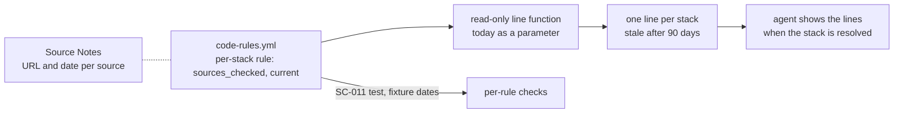
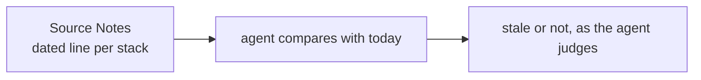
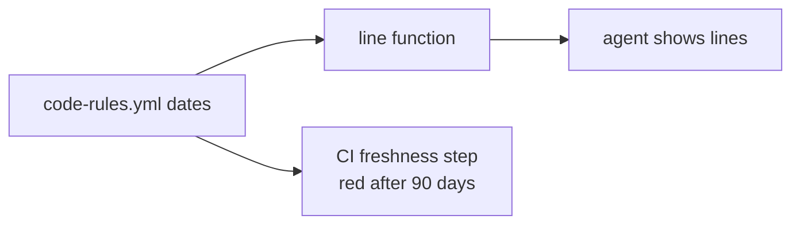

# Design Analysis — Feature 205 / Iteration 003

**Feature**: 205-workshop-lens-order
**Iteration**: 003 (the code-implementation lens refresh, proposal 220's status history, the grouped agenda)
**Date**: 2026-11-15
**Spec**: file:///C:/Dev/specrew-220-workshop-lens-order/specs/205-workshop-lens-order/spec.md (FR-030, FR-031, FR-032; SC-011)
**Amendment record**: file:///C:/Dev/specrew-220-workshop-lens-order/specs/205-workshop-lens-order/workshop/intake-drift-log.md (DRIFT-205-INTAKE-006)

## Problem Framing

Three pieces of work, none waiting for feature 203:

- **FR-030**: the code-implementation lens's per-stack rules were last checked on 2026-06-08 and carry version
  numbers in their rule text (for example the C/C++ rule's language standards). The recorded Light run showed a session
  calling a .NET release short-support before correcting itself (iteration 002, DRIFT-019 item 5). The lens must be
  refreshed from official release notes, carry a sources-checked date per stack, show one "last checked" line per stack
  when it runs, and mark a line stale after 90 days. Version numbers may appear only in that dated line and in Source
  Notes (SC-011).
- **FR-031**: proposal 220's status history records the iteration change and the order agreed after iteration 002.
- **FR-032**: the agenda shows its selected lenses under three headings from index.yml's `space` tag, each with a text
  label and one coloured marker. The design was agreed at iteration 002's DRIFT-014 and the wording accepted on
  2026-11-15 (DRIFT-205-INTAKE-006). It is not reopened here.

## Key Design Decision Points

1. **How the "last checked" line and its stale marker are produced (FR-030)**: by code a test can drive with a fixture
   date, or by the agent comparing dates as it reads the lens.
2. **Where the sources-checked dates live (FR-030)**: on each per-stack rule in `code-rules.yml`, or only in the lens
   prose.
3. **Settled, recorded here for the plan (FR-032)**: the grouping is computed where the canonical agenda block is
   made, `confirm-workshop-agenda.ps1`'s `Get-CanonicalWorkshopAgendaText`, so the block the hook checks and the block
   the human reads stay one text. The markers are non-ASCII, so the script must write UTF-8 to its output stream: the
   agent pastes that output, and the conformance provider compares the pasted block with the stored `canonical_text`.
   A block that reaches the agent as `??` would not match, and the agenda confirmation would not bind.

## Alternatives

### Option A: Simplest — dates on the per-stack rules, one read-only helper renders the lines

**Approach**:

- Each of the six per-stack rules in `code-rules.yml` gains a `sources_checked` date. The version facts move out of
  the rule text into a `current` field on the same rule, the only place outside Source Notes where they may appear.
- A read-only function in `scripts/internal/code-implementation-lens.ps1` returns one line per stack: "<stack> —
  sources last checked <date>: <current>". A line older than 90 days ends with "— stale: check the release notes
  before relying on it". The function takes today's date as a parameter, so a test can pass a fixture date.
- The lens's Workshop Conduct tells the agent to show those lines when the stack is resolved. The design-workshop
  skill's sentence that the lens helper "is not invoked mid-workshop" gains the exception for this read-only call.
- Source Notes list each stack's sources with URL and the date checked. Facts that could not be confirmed are left out.
- Tests: SC-011 per rule. Each per-stack rule has a date; no rule's `default` or `title` holds a version number; a
  fixture date 91 days on shows the stale marker and 90 days does not. Self-tests swap a date, remove one, and put a
  version back into rule text (iteration 002's lesson 1: per item, not totals).

**Architectural pattern**: data on the catalog entry, rendered by one pure function. The lens prose stays free of
volatile facts.

**Quality features considered**:

- *requirements-nfr*: SC-011 is proven by a test that fails first, with a fixture date.
- *architecture-core*: one pure function beside the existing catalog loader; no state.
- *data-storage*: two optional fields on six catalog entries; the manifest schema is unchanged.
- *devops-operations*: copies refresh through the two project-only deploy scripts, with the hash record updated.
- *code-implementation*: no new dependency; PowerShell 7, test-first.

**Effort estimate**: 3 SP for FR-030.

**Reversibility cost**: High. Two fields, one function, lens text; a revert restores today's lens.

**What the human sees when a date is stale**: when the stack is resolved, the lens shows one line per stack, for
example "C#/.NET — sources last checked 2026-11-15: <current versions>". After 90 days the line ends "— stale: check
the release notes before relying on it", every time the lens runs, until the catalog is refreshed. The workshop goes
on; the human knows that line's versions may be out of date, and the agent looks them up before recommending one.

**Trade-offs**: one more call the agent makes in the code lens. The skill's "not invoked mid-workshop" sentence gains
an exception, which is a wording change the reviewer must check.

**Diagram**:



### Option B: Reasonable — dates in the lens prose; the agent compares them with today

**Approach**: Source Notes carry one dated line per stack, and the conduct tells the agent to say "stale" when a date
is more than 90 days old. The rule text loses its version numbers. Tests check that each stack has a date and that no
rule holds a version.

**Architectural pattern**: prose-only. The lens carries the dates and the agent does the arithmetic at run time.

**Quality features considered**:

- *requirements-nfr*: the stale marker cannot be proven by a test. SC-011's fixture clause would need a spec change.
- *data-storage*: no catalog change.
- *code-implementation*: the cheapest option, but it relies on the agent's date arithmetic, the kind of fact the run
  got wrong.

**Effort estimate**: 2.5 SP for FR-030, plus a clarify change to SC-011.

**Reversibility cost**: High. Lens text only.

**What the human sees when a date is stale**: the same words as Option A only if the agent compares the dates
correctly. If it does not, the human sees a stale line with no marker, or a marker on a fresh one, and nothing tests
which.

**Trade-offs**: it does not meet SC-011 as written, and it leaves a run-time fact to the agent.

**Diagram**:



### Option C: By-the-book — Option A plus a CI freshness check

**Approach**: Option A, plus a CI step that fails once any stack's date passes 90 days, so the catalog cannot go stale
unnoticed.

**Architectural pattern**: Option A's data and function, with a calendar-driven gate in CI.

**Quality features considered**:

- *devops-operations*: a red build caused by the calendar, on every branch at once, unrelated to the change being
  pushed. That is the kind of outside-the-push CI failure iteration 002 counted three of in one night.
- *requirements-nfr*: freshness enforced, not only shown.

**Effort estimate**: 3.5 SP for FR-030.

**Reversibility cost**: Medium. A CI step that other features' pushes depend on.

**What the human sees when a date is stale**: in the workshop, the same line and marker as Option A.

**What the red build does to other branches**: on the day the oldest date passes 90 days, the freshness step fails
on every branch's next CI run, whatever that push changed: each open feature's push goes red at once, and under the
CI rule each of those features stops for a ruling. The builds stay red until a refreshed catalog lands on main and
each branch takes it in. A feature in the middle of a review stop or a pin advance is blocked by a date, not by its
own change.

**Trade-offs**: it enforces freshness at the cost of unrelated red builds. FR-030 asks for the marker to be shown, not
for the build to fail.

**Diagram**:



## The grouped agenda (FR-032), as agreed

```text
Workshop agenda

Selected lenses:

🟦 Problem space
- requirements-nfr (medium): ...

🟪 Both spaces
- data-storage (light): ...
- devops-operations (light): ...

🟧 Solution space
- architecture-core (medium): ...
- code-implementation (medium): ...

Skipped lenses:
- ui-ux: ...
```

- **Markers**: problem space 🟦 (U+1F7E6, blue square), both spaces 🟪 (U+1F7EA, purple square), solution space 🟧
  (U+1F7E7, orange square). Blue against orange is the pair most readers with colour-vision deficiency can still tell
  apart, and the text label carries the meaning in every case.
- **Lens-open heading**: the skill's lens opening repeats the group's marker, for example "🟦 requirements-nfr".
- **Rendering in a Claude Code terminal**: the markers are plain Unicode text in the assistant message. Windows
  Terminal and the usual macOS and Linux terminals draw them as colour emoji two cells wide. The plan carries a recorded
  render check in a scratch project to confirm this on this machine, before review.
- **Fallback**: on a host that cannot draw them (a legacy console font shows an empty box), the heading still reads
  "Problem space", "Both spaces" or "Solution space". No meaning is lost, so no switch is added. If the output stream is
  not UTF-8, the script still writes UTF-8 (decision point 3), so the agent never receives `??`.
- **Unchanged**: the `Selected lenses:` and `Skipped lenses:` lines, the closing question, the digest (computed from
  the structured agenda, not the text), and the index.yml order check.

## Sizes (story points)

| Work | Option A | Option B | Option C |
| --- | --- | --- | --- |
| FR-030 test, red-first, per-rule self-tests (SC-011) | 1 | 0.5 | 1 |
| FR-030 refresh: release notes for six stacks, rules, Source Notes | 1.5 | 1.5 | 1.5 |
| FR-030 line function and conduct (A, C) or prose dates (B) | 0.5 | 0.5 | 0.5 |
| FR-030 CI freshness step (C) | — | — | 0.5 |
| FR-032 test, red-first: real catalog, a changed-tag fixture, the kept lines, UTF-8 round trip | 0.75 | 0.75 | 0.75 |
| FR-032 renderer, skill lens-open marker and agenda template | 0.75 | 0.75 | 0.75 |
| FR-032 recorded render check in a scratch project | 0.5 | 0.5 | 0.5 |
| FR-031 proposal 220 status history and `proposals/INDEX.md` | 0.5 | 0.5 | 0.5 |
| copies, hash record, parity, workshop regression, CI steps | 1 | 1 | 1 |
| rework buffer (iteration 002 retro calibration) | 2 | 2 | 2 |
| **Total** | **8.5** | **8** | **9** |

All three fit the cap of 20. The review-signoff crossing stays unplanned while it stays small (iteration 002 retro,
calibration).

## Applicable Lenses

The same lenses as the intake workshop (`lens-applicability.json`), for this iteration's change.

- **requirements-nfr** - `extensions/specrew-speckit/knowledge/design-lenses/requirements-nfr.md`
  - Decision points: Which NFRs are design drivers for this slice?; Which constraints are mandatory rather than preferences?; Which requirements need a measurable threshold?; Which requirements are unknown enough to require clarification?; Which acceptance criteria prove the quality, not only the happy path?
  - Addressed:
    - Drivers: no unconfirmed fact in the code lens (FR-030); colour never carries meaning alone (FR-032).
    - Thresholds: stale after 90 days; three headings in index.yml order; SC-011 and FR-032's test clause.
    - Acceptance is proven per item, with swap, remove and reword self-tests (iteration 002 retro action 1).
- **architecture-core** - `extensions/specrew-speckit/knowledge/design-lenses/architecture-core.md`
  - Decision points: Which design method / decomposition style governs the structure?; What are the major building blocks and their responsibilities?; Which areas are volatile and should be isolated?; Which option best balances simplicity, reversibility, and future cost?
  - Addressed:
    - The volatile facts (versions, dates) are isolated on six catalog entries under Option A.
    - The agenda grouping lives where the canonical block is made, so there is one text.
    - Options A, B and C above; A is the simplest that meets SC-011 as written.
- **data-storage** - `extensions/specrew-speckit/knowledge/design-lenses/data-storage.md`
  - Decision points: Is persistent storage required, or is derived/transient state enough?; What owns each data type?; How is retention handled?; Which storage model fits?; What consistency model is required?; How are schema changes, migrations, backup, and restore handled?; How does the design avoid services talking directly to another service's private database?
  - Addressed:
    - Two optional fields on per-stack catalog rules; the implementation-rules manifest schema is unchanged.
    - The agenda proposal file keeps its shape; only its `canonical_text` gains the headings.
- **devops-operations** - `extensions/specrew-speckit/knowledge/design-lenses/devops-operations.md`
  - Decision points: What is the hosting model?; Which environments must be equivalent?; What CI/CD stages, gates, rollout strategy, and rollback path are required?; What users, roles, service identities, and permissions are needed?
  - Addressed:
    - Copies refresh through the two project-only deploy scripts, and the hash record is updated in the same commit.
    - The new tests run as named `specrew-ci.yml` steps; no calendar-driven CI gate under the recommended Option A.
- **code-implementation** - `extensions/specrew-speckit/knowledge/design-lenses/code-implementation.md`
  - Decision points: Source of code-rules truth; Resolved stack; Baseline craft posture; Consequential forks; Dependency selection; Reviewer.
  - Addressed:
    - This lens is the FR-030 subject; refreshed from official release notes fetched at implementation time.
    - Repo conventions, PowerShell 7, test-first; no new dependency; reviewer codex.

*Not selected (workshop agenda, with reasons in `lens-applicability.json`): component-design, ui-ux, security-compliance, integration-api, observability-resilience.*

## Crew Recommendation

**Recommended: Option A.** It meets SC-011 as written, with the stale marker proven by a fixture date, and keeps the
version facts out of the lens prose. It adds one pure function and no CI gate. Option B relies on the agent's date
arithmetic and needs a spec change. Option C turns the calendar into red builds on every branch.

## Human Decision

- **Decision verdict**: approved for plan with Option A
- **Chosen option**: Option A
- **Reason**: a `sources_checked` date on each of the six per-stack rules and one pure, read-only line function that
  takes today as a parameter. It meets SC-011 as written, with the stale marker proven on a fixture date, and keeps
  the version facts out of the lens prose. Option B leaves the date arithmetic to the agent, untested, and needs a
  spec change. Option C turns the calendar into red builds on every open branch.
- **Modifications**: none to the design. FR-032 stays as agreed at 13:27 (markers 🟦 problem, 🟪 both, 🟧 solution;
  UTF-8 output; the `Selected lenses:` line kept).
- **Verdict given**: typed by the maintainer on 2026-11-15.
- **Design-analysis draft commit**: `7bd52f2b` (the draft `fcc5465e` plus what the human sees when a date is stale)
