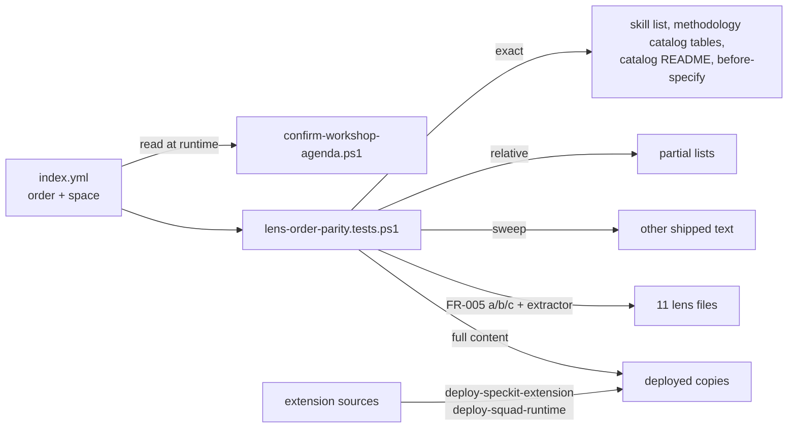
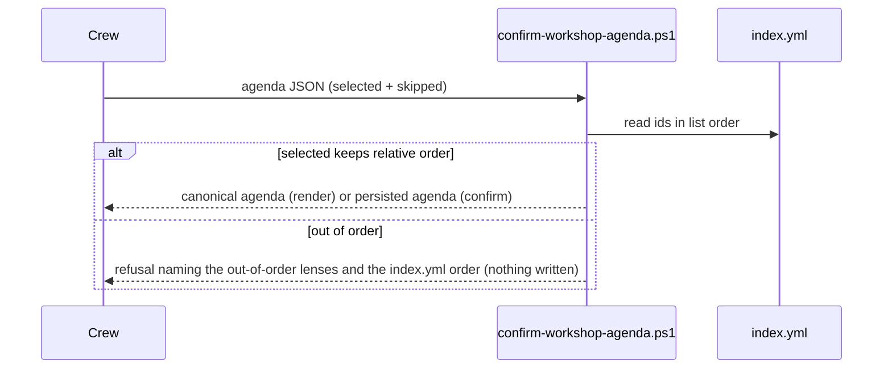
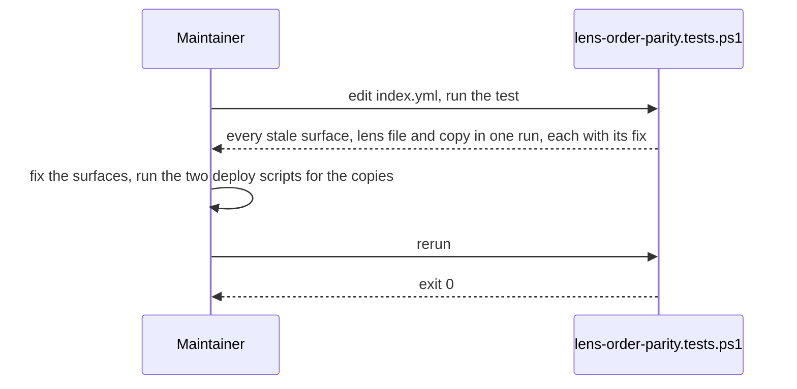

# Review Diagrams: Workshop Lens Order

**Feature**: 205-workshop-lens-order
**Phase**: pre-implementation (planning artifact for reviewer)

## Component diagram

## Sequence: confirming a new agenda

## Sequence: a maintainer changes the order

