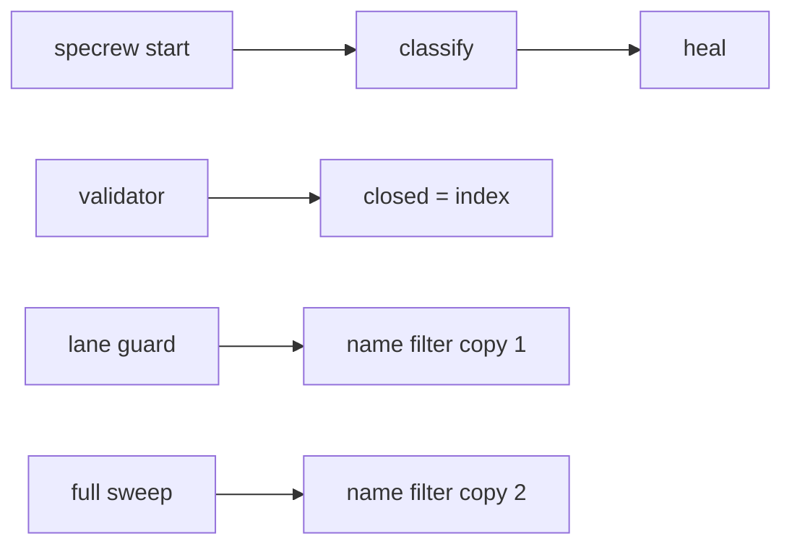
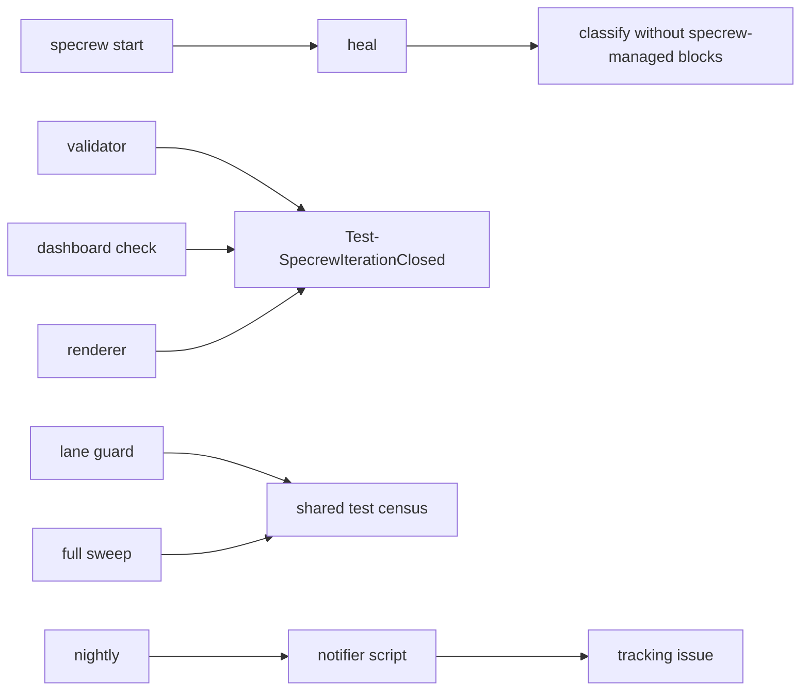

# Design Analysis — Feature 206-bug-bash / Iteration 001

**Feature**: 206-bug-bash
**Iteration**: 001
**Date**: 2026-11-10
**Spec**: file:///C:/Dev/specrew-206-bug-bash/specs/206-bug-bash/spec.md
**Scope of this analysis (maintainer, 2026-11-10)**: only the six fixes with a real design choice. The
others have one obvious shape and go straight to the plan: the dirty-tree separator (FR-002), the stray
root `package.json` and its dependent test (FR-014), the empty `_ctl-spec.ps1` (FR-013), the "Complete
iterations" message (FR-010), 198/011 and 197/006 marked abandoned (FR-005, FR-006), and the item 3
hand-over (FR-004).

## Quality profile note

`resolve-quality-profile.ps1` selected `react-spa-public@v1.0.0` for this feature. That is bug 6a (the
stray root `package.json` plus words such as "browser" and "component" in the spec), reproduced live. The
plan uses a custom PowerShell composition instead and records the wrong preset as evidence for FR-014.

## Problem Framing

Every fix here repairs a signal that is false today: a prompt that loops instead of refusing, a check that
flags Specrew's own write as the user's, three definitions of "closed" that disagree, a nightly nobody
hears, and a test census defined by file name. The design question for each is how much structure the fix
needs to stay true, not whether to fix it. Constraints: failing test first, one bug per commit, nothing in
feature 203's protected files, no writes to the real home folder.

## Key Design Decision Points

1. D1 — FR-001: what the recovery prompt does with no console input.
2. D2 — FR-003: how the change check tells Specrew's instruction heal from a user change.
3. D3 — FR-008a: the one definition of "closed".
4. D4 — FR-008 (option D): how closed iterations stop being re-judged.
5. D5 — FR-009: where the tracking-issue logic lives.
6. D6 — FR-011: the shape of the test census.

### Decision point detail

#### D1 — FR-001: the no-console recovery prompt

Today `Read-SpecrewRecoveryChoice` (`scripts/internal/session-recovery.ps1:430`) loops on `Read-Host`
forever when no console input exists. `Read-SpecrewYesNo` in the same start path already checks
`[Console]::IsInputRedirected`; the recovery prompt never got that guard. `--recovery-choice A|B|C` already
exists.

- **A (Simplest)**: when console input is not available, the function refuses instead of prompting.
  `specrew start` prints a plain refusal that names `--recovery-choice A|B|C` and exits non-zero.
- **B (Reasonable)**: A, plus an interactive console gets at most three invalid answers before the same
  refusal, so no input path can loop.
- Not chosen in either: reading a piped answer from stdin. An open but silent stdin blocks the read, which
  is the B5F-034 hang class.

#### D2 — FR-003: Specrew's own instruction heal read as a user change

`specrew start` heals the coordinator section into `.github/copilot-instructions.md` before it classifies
changes, and the classifier compares the last-start commit with the working file. The healed section is
delimited by `<!-- >>> specrew-managed … >>> -->` / `<!-- <<< specrew-managed … <<< -->` markers
(`scripts/internal/instruction-file-merge.ps1`).

- **A (Simplest)**: classify before the heal. Flaw: the healed section stays in the working file, so the
  next start compares a baseline without it to a file with it and pauses again, on every start until the
  user commits a baseline that contains it.
- **B (Reasonable)**: the classifier removes every `specrew-managed` marker block from both sides before it
  compares, so a change inside Specrew's section is never the user's. A change outside the markers is
  classified as today.

#### D3 — FR-008a: one definition of "closed"

Three disagree today:

1. the closed-iteration index, `.specrew/closed-iterations.yml`;
2. a state.md text heuristic (`Get-SpecrewClosedIterationFromStateFile`: phase words, "RETRO COMPLETE",
   "Retrospective complete");
3. the dashboard renderer (`scripts/internal/dashboard-renderer.ps1:600`): closed if the phase says
   closed/complete, **or if review.md's verdict contains "accepted"**. That is why 048/001, 197/001,
   197/006 and 198/008 (verdict text "… T066 review signoff is accepted") count as closed for the
   dashboard check while the nightly validates them as open.

- **A (Simplest)**: closed means "listed in the index", nothing else. Risk: an iteration whose closeout ran
  but whose index write failed would be judged as open.
- **B (Reasonable)**: one function, used by the validator's closed filter, the dashboard check and the
  renderer: closed means listed in the index, or `Iteration Status` is `complete` or `abandoned` (the
  canonical enums). The text heuristic and the review-verdict rule are removed. Frozen-list entries are
  named explicitly and are not closed.

#### D4 — FR-008 (option D): how closed iterations stop being re-judged

Only one check judges closed iterations today: the dashboard check. It already has a hard-coded start, by
feature number (features 017 and later). Its whole history is now on the frozen list.

- **A (Simplest)**: the frozen list only (`.specrew/legacy-frozen.yml`, entries with a one-line reason, a
  test pinning its content). No ship dates yet. Short of FR-008's text, which asks each closed-iteration
  check to carry the date it shipped.
- **B (Reasonable)**: A, plus each check that judges closed iterations declares `since` (its ship date).
  Iteration-closeout writes a real `closed_at` from now on. An iteration with no real closure date (the 131
  index entries stamped by the 2026-08-06 rebuild) is judged only through the frozen list. The dashboard
  check's feature-number cut-off becomes its `since` date, 2026-05-26 (`d4284c8a`).

#### D5 — FR-009: the tracking-issue notification

- **A (Simplest)**: inline `gh` shell steps in the nightly workflow (`if: failure()` / `if: success()`),
  with `issues: write`.
- **B (Reasonable)**: a PowerShell script owns the logic. Find the open issue by label, compare the
  failure-set fingerprint (a hash of the sorted failing iterations and messages) stored in its body, then
  open, comment or close. Its `gh` calls are injectable, so a Pester test proves "first red opens, same
  failures stay quiet, changed failures comment, green closes" before the workflow uses it.

#### D6 — FR-011: the test census

The lane guard and the release full sweep each count only files named `*test.ps1` / `*tests.ps1`, in two
separate copies of the same rule.

- **A (Simplest)**: change the filter in both copies to every `.ps1` under `tests/` except `fixtures/` and
  `support/`, plus an explicit list of helper files.
- **B (Reasonable)**: one shared census function used by both the guard and the full sweep. It classifies
  by content (`Describe` makes a file Pester, otherwise a script), and the excluded files live in one list,
  each with a reason. Two copies of one rule is how this blind spot lasted.

## Alternatives

### Option A: Simplest — minimal local edits

**Approach**: D1 refuse when no console input exists. D2 classify before the heal. D3 closed means "listed
in the index". D4 the frozen list only, with no ship dates. D5 inline `gh` shell steps in the nightly
workflow. D6 change the name filter in both copies of the census.
**Architectural pattern**: in-place patch of each existing site.
**Quality features considered**: correctness of each signal; testability is weakest for D5 (shell inside
YAML).
**Effort estimate**: about 60 percent of Option B.
**Reversibility cost**: Low — each edit is local.
**Trade-offs**:

- (+) fewest lines changed; no new files beyond the frozen list.
- (−) D2 brings the false pause back on the next start, because the healed section stays in the working
  file.
- (−) D4 falls short of FR-008 as written (no `since` per closed-iteration check).
- (−) D6 keeps two copies of one rule, the shape that let this blind spot last.

**Design principle / why this matters**: cheapest change at each site, at the cost of leaving the
duplication and ordering that caused two of these bugs.

**Recommended for**: a hotfix that must ship the same day.

**Diagram**:

### Option B: Reasonable — one source of truth per signal

**Approach**: D1 refuse when no console input exists, and cap an interactive console at three invalid
answers. D2 the classifier strips `specrew-managed` marker blocks from both sides before comparing. D3 one
function (index membership, or `Iteration Status` `complete` / `abandoned`) used by the validator, the
dashboard check and the renderer. D4 the frozen list, plus a `since` date on each closed-iteration check and
a real `closed_at` written at closeout from now on. D5 a PowerShell notifier with injectable `gh` calls and
a Pester test. D6 one shared census function used by the lane guard and the full sweep, with one exclusion
list carrying reasons.
**Architectural pattern**: single source of truth for each shared rule; Specrew-owned content is
recognised by its markers, not by ordering.
**Quality features considered**: correctness, testability (every fix gets a failing test first),
maintainability (no duplicated rules), operability (D5's notification can be proved offline).
**Effort estimate**: baseline (1.0).
**Reversibility cost**: Low to Medium — the shared closed function and census function each have several
callers.
**Trade-offs**:

- (+) the false pause cannot return; the three "closed" answers cannot drift apart again; the census
  cannot diverge between guard and sweep.
- (+) D5's behaviour is proved by a test before the workflow uses it.
- (−) three new small units (closed function, census function, notifier script) to review.

**Design principle / why this matters**: each of these bugs came from a rule stated twice or a write that
was not recognised as Specrew's own; Option B removes the second statement instead of patching both.

**Recommended for**: this feature.

**Diagram**:

### Option C: By-the-book — not meaningfully distinct

A by-the-book shape would add a per-rule registry with ship versions (options A or C of the FR-008
discussion) and a generic notification abstraction. The maintainer has ruled the registry a later item, and
one notification channel has been chosen, so By-the-book is not meaningfully distinct from Option B here.

## Applicable Lenses

None selected: bug-bash conduct, root causes were known before the feature. No lens questionnaire has been
answered for this iteration, by the maintainer's ruling (2026-11-10); if a gate requires one, the agenda
skipping every technical lens goes to the maintainer for typed confirmation rather than being filled in.

## Crew Recommendation

**Recommended: Option B.**

D2 decides it: reordering the classifier does not stop the false pause, because the healed section stays in
the working file and is compared again on the next start; only recognising Specrew's marker blocks removes
it. D3 and D6 have the same root as the bugs themselves, a rule stated more than once. One closed function
and one census function end the disagreement instead of aligning copies that can drift again.

D4 meets FR-008 as written with a single `since` date and a closure stamp from now on, while history stays
on the frozen list. D5 lets FR-009 start with a failing test, as the feature's rules require.

## Human Decision

**Status**: pending. Awaiting the maintainer's verdict.
