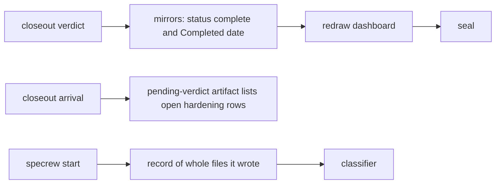
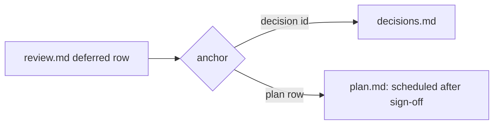

# Design Analysis — Feature 206-bug-bash / Iteration 002

**Feature**: 206-bug-bash
**Iteration**: 002
**Date**: 2026-11-15
**Spec**: file:///C:/Dev/specrew-206-bug-bash/specs/206-bug-bash/spec.md (with Amendment A1, FR-015 to FR-018)
**Scope (maintainer, 2026-11-15, 11:31 local, relayed; DRIFT-206-002)**: the work carried from iteration 001 plus bug
list items 37, 39, 41 and 44. Only the points with a real design choice are analysed here. The rest have one obvious
shape and go straight to the plan: T016 (FR-013), T017 (FR-014), DRIFT-206-I001-010, and items 12, 17, 18, 23 to 25,
30 to 34.

## Quality profile note

`resolve-quality-profile.ps1` again selects a React preset for this feature. That is bug 6a, which T017 fixes in this
iteration. The plan keeps iteration 001's custom PowerShell composition.

## Problem Framing

Every item repairs a signal that is false today, or a step a human repeats at every boundary. There are three kinds:

- a fixture or classifier that reads the developer's machine instead of the tree (SC-001, SC-002);
- a validator rule that has no honest value for a true state (FR-015, FR-016);
- a closeout that leaves its own records wrong, for the human to fix after the verdict (FR-017, FR-018).

The constraints from iteration 001 stand: a failing test first and one bug per commit; none of feature 203's
protected files touched; the real home folder never written.

**Feature 203's overlap was checked on its branch** (`origin/203-beta5-stabilization`, since the merge base
`df1141a8`):

- It has not changed `validate-governance.ps1`, either copy, or `gate-preflight.ps1`. FR-015 and FR-016 are clear of it.
- It has not changed `specrew-start.ps1`, `session-recovery.ps1`, `instruction-file-merge.ps1`, `specrew-init.ps1`,
  `squad-deploy.ps1`, the census guard, the notifier, the two workflows or the dashboard renderer. The carried work is
  clear of it, apart from `specrew-where.ps1`, where it added 5 lines.
- It has changed `extensions/specrew-speckit/scripts/shared-governance.ps1` by 321 lines added and 23 removed, in 15
  commits. This is where FR-017 and FR-018 land, so D3 and D4 below weigh each route against those hunks.

## Key Design Decision Points

1. **D1 — FR-015 (item 37):** what a `deferred` task verdict is anchored to.
2. **D2 — FR-016 (item 39):** how the staleness check knows a verdict is still pending, when CI cannot see
   `start-context.json`.
3. **D3 — FR-017 (item 41):** where the closeout dashboard is redrawn after the verdict.
4. **D4 — FR-018 (item 44):** how the Completed date and the hardening rows are settled before the packet.
5. **D5 — SC-002 (item 21):** what `specrew start` does with whole files it created or repaired itself.
6. **D6 — SC-001 (item 22):** a governed project with no session files, as in a fresh clone.

### Decision point detail

#### D1 — FR-015: the anchor of a `deferred` verdict

- **D1-a, decision id only (1.0 SP).** The row names a decision in `.squad/decisions.md`, as FR-015 says now.
  - This covers 206's T003, which was deferred by a decision during the iteration.
  - It does not cover 203's T014. That task was scheduled after sign-off by the plan itself, with no decision.
  - Under this option FR-015 is corrected to say so, and T014's case stays with proposal 206.
- **D1-b, two anchors (1.5 SP).** The row names either a decision id or the plan row that schedules the task after
  sign-off. The validator checks that the plan row exists and says so. This covers both cases, as FR-015 is written.
- **Recommended: D1-a.** It is the case item 37 was raised for and the one the retro's action 6 names. D1-b adds a
  second rule on free text (what counts as "the plan row says after sign-off"), which iteration 001's lesson 1 says to
  build only from listed affirmative forms. That is the extra 0.5 SP, and the iteration has no room for it.
- **The spec change either way.** FR-015's sentence "Both known cases are covered" is corrected before
  implementation: under D1-a to "206's T003; 203's T014 stays with proposal 206", under D1-b to name the second anchor.

#### D2 — FR-016: knowing the verdict is pending when CI cannot see it

- **The finding.** `.specrew/start-context.json` is ignored by git (`.gitignore:61`), and so is
  `.specrew/runtime/pending-verdict-stop.md` (`.gitignore:30`). CI has neither file. Specrew CI Lint is where the red
  push happens, so a check that reads the pending crossing from start-context cannot tell anything apart in CI.
- **The order today, for reference:**
  1. The record is committed and pushed.
  2. The boundary sync runs. It needs the record's commit on origin (`verdict-commit-durable`).
  3. The human gives the verdict.
  4. The capture writes the phase line: `Sync-SpecrewCrossingMirrors` moves plan.md.

  So at the push, nothing committed says "pending" either.
- **D2-a, local truth, CI tolerant (1.0 SP).**
  - Where start-context is present, the four cases are judged exactly as FR-016 says.
  - Where it is absent (CI, a fresh clone), "record beside the earlier phase" is accepted with a warning naming the
    missing file.
  - The case of a recorded verdict with the line behind still fails locally. The capture's mirror-issue check
    (`Get-SpecrewCrossingMirrorIssues`, at the next sync) also catches it.
- **D2-b, infer from git history (1.5 SP).** CI reads `boundary(<stage>)` commit subjects to decide whether a verdict
  was recorded. This rests on a commit-message convention, which is free text again, and a squash or a rename breaks it.
- **D2-c, move the phase line with the record.** Rejected: the line would be ahead of the verdict, which the existing
  state-advance check rightly refuses.
- **Recommended: D2-a.** It is the only option that is honest in CI. The case it gives up in CI, a verdict with the line
  behind, already has a local check and a mirror check, and CI never had the information to judge it.
- **The spec change.** FR-016 gains one sentence: where `start-context.json` is absent, the record-before-verdict state
  is accepted with a warning.

#### D3 — FR-017: where the closeout dashboard is redrawn

The capture, `Add-SpecrewBoundaryAuthorization` in `shared-governance.ps1`, does this at iteration-closeout, in order:

1. it writes the closed-iteration index entry;
2. it writes the mirrors (`Sync-SpecrewCrossingMirrors`);
3. it calls `Invoke-SpecrewCloseoutSeal` as "the capture's last act".

Where 203's four hunks in this function sit, against the merge base:

| Base lines | What 203 changes |
| --- | --- |
| 4199 | new parameters for the cited turn |
| 4253 | the captured-provenance block moved, and the cited-turn re-derivation added |
| 4299 | 9 lines removed |
| 4336 | the turn identity written on the entry, and the before-implement budget snapshot |

- The seal call is at base line 4446, about 100 lines below the last of those hunks.
- `Invoke-SpecrewCloseoutSeal` (base 8168 to 8343) is not touched by 203.

The options:

- **D3-a, inside the capture, just before the seal call (1.25 SP).** The redraw runs after the mirrors and before the
  seal. A failure warns and does not block the seal, as the arrival's draw does today.
  - Textual risk: low. No 203 hunk is within 100 lines.
  - Semantic risk: 203 changes how the capture is entered (the cited turn), not its closeout tail.
- **D3-b, inside `Invoke-SpecrewCloseoutSeal`, behind a switch the capture passes (1.25 SP).** The function is
  untouched by 203, and only the capture's call line changes. The switch is there because the seal is also used by
  `specrew reseal`: a reseal must not redraw a closed iteration with later data unless asked.
  - Risk: as D3-a, plus a second caller to keep right.
- **D3-c, detection only (0.75 SP).** The validator flags a sealed closeout dashboard whose phase is not
  `iteration-closeout`, and the closeout packet tells the crew to redraw and reseal. Nothing in `shared-governance.ps1`
  changes, but the human's extra step stays at every closeout, which is what item 41 is about.
- **D3-d, not in iteration 002.** A hand-over to 203, or after 203 merges.
- **Recommended: D3-a.** The capture already owns "the last act before the seal", and the redraw belongs there. It
  avoids D3-b's second caller, and its distance from 203's hunks keeps the merge to a rebase. D3-c is the fallback if
  the maintainer wants nothing in that file.

#### D4 — FR-018: the Completed date and the hardening rows

- **D4-a, the capture writes the date, and the arrival names the rows (1.5 SP).**
  - The date: `Sync-SpecrewCrossingMirrors`, which already moves plan.md to `complete`, writes `**Completed**:` with the
    verdict's date in the same write. 203 has not changed this function (base 3986 to 4067; its nearest hunks are at
    3820 and 4140).
  - The rows: the retro → iteration-closeout arrival (`sync-boundary-state.ps1`) lists every hardening row still at
    `planning-time-analysis` / `pending-post-implementation` in the pending-verdict artifact, and the packet names them
    as owed. 203 added 3 lines to that file, at line 1778, far from the closeout block at 2055.
- **D4-b, both named as owed in the packet (1.0 SP).** Nothing in `shared-governance.ps1` changes. The date cannot be
  written before the verdict, since the verdict may come another day. So the crew still writes it after the verdict,
  and the boundary commit is red on its own, which is the cost item 44 is about.
- **D4-c, not in iteration 002.**
- **Recommended: D4-a.** It removes the step after the verdict for good. The function it changes is clear of 203's
  hunks.

#### D5 — SC-002: whole files `specrew start` wrote itself

The facts, from item 21: the first start heals `.github/agents/squad.agent.md` and creates five
`.squad/agents/*/charter.md` files; the test commits everything; the second start reads them as user changes and
pauses. T003's matched-block rule covers only `copilot-instructions.md`.

- **D5-a, a record of what start wrote (2.5 SP, plus 0.5 SP for review findings on the classifier).**
  - When start creates or repairs a whole file, it records the file's path and SHA-256 in a git-ignored runtime
    record.
  - On the next start, a file whose hash equals the recorded one is Specrew's own, and its change is bookkeeping.
  - Any edit changes the hash, so it is the user's.
  - With no record, as in a fresh clone, the file counts as the user's, so the error is toward pausing.
  - The record is ignored by git, so no tracked file carries machine data (item 6b's class).
- **D5-b, a list of Specrew-owned paths.** Rejected: a user's edit to a charter would be missed, which is the false
  negative FR-003 exists to prevent.
- **D5-c, regenerate and compare with the template output.** Rejected: it depends on the installed version and
  repeats the healer's work at every start.
- **Recommended: D5-a.** It is the smallest rule that stays true. It treats Specrew's own write as its own and nothing
  else.
- **Also in SC-002's work:** item 29's remainder. `validator-hardening-iteration2.ps1` builds its fixture from every
  file git does not ignore, and is tested in the preflight's layout (lesson 5). Then the script runs green and is
  registered in the release manifest.

#### D6 — SC-001: a governed project with no session files

- **D6-a, `specrew start` treats it as fresh (1.0 SP).** It treats a governed project with neither
  `last-start-prompt.md` nor `start-context.json` as a first start: it re-anchors from the spec and does not refuse. A
  file that is present but unreadable still refuses, as T001 made it.
- **D6-b, the test passes `--recovery-choice A` (0.25 SP).** The test goes green, but a fresh clone of any governed
  project still refuses a no-console start, in CI or for a new collaborator.
- **Recommended: D6-a.** A fresh clone is a real user's first start, and refusing it is the bug. Items 23 to 25 go with
  it in any case:
  - a resume path outside `-ProjectPath` is refused, and the tracked identity file stops carrying an absolute path;
  - the fixture copies every file git does not ignore;
  - the Squad probe runs in a temp folder, and a failed cleanup is reported.

## Capacity

The cap is 20 SP (`.specrew/iteration-config.yml`, overcommit threshold 1.0). The calibration from iteration 001's
retro is applied:

- 0.25 SP per expected review finding on a rule over free text or a reader of YAML or shell;
- a review-signoff line, at 0.5 SP rather than 1, because FR-016 lands before sign-off and should remove that push's
  red Lint;
- the reviewer-brief promotions, as a planned task.

With the recommended choices, everything sizes to **25.25 SP**:

- the carried work, 19.75 SP;
- the four items, 4.75 SP (D1-a 1.0, D2-a 1.0, D3-a 1.25, D4-a 1.5);
- the sign-off line and the brief task, 0.75 SP.

That is 5.25 over the cap.

**Proposed out, to iteration 003 (5.25 SP).** Following the reviewer's advice, which the maintainer heard: keep the
four, and move out the carried items of lowest value.

| Item | SP | Why it can wait |
| --- | --- | --- |
| 15 | 1.5 | tests that load the installed module's renderer; it affects only machines with the module installed, and CI has none |
| 16 | 0.5 | a stale README assertion; the script is already excluded with that reason |
| 19 | 0.75 | `feature-017-dashboard-core.ps1`'s fixture; excluded with its cause |
| 20 | 1.0 | `feature-018-rich-dashboard.ps1`'s golden file; excluded, and its cause not yet established |
| 28 | 0.75 | T002's suite takes 310 s per push; a cost, not a wrong result |
| 35 | 0.75 | two tracking issues need two failed nightlies running at once |

**What stays (20.0 SP):**

- SC-002 and SC-001 with items 21 to 25 and 29;
- T016 and T017;
- DRIFT-206-I001-010, which blocks the feature's closeout;
- items 12, 17 (high severity), 18, 30 with 34, 31 with 32, and 33;
- the four new items, the sign-off line and the brief task.

Under D1-b or D3-b the total rises by 0.5 or 0; D1-b would need item 12 and item 18 (0.5) moved out as well. Under D3-c
and D4-b it falls by 1.0, which would let item 16 back in with 0.5 SP to spare.

## Alternatives

### Option A: Simplest — clear of 203, nothing in `shared-governance.ps1`

**Approach**: D1-a, D2-a, D3-c (the validator flags a sealed closeout dashboard whose phase is not
`iteration-closeout`), D4-b (the Completed date and the open hardening rows named as owed in the packet), D5-a,
D6-b (the test passes `--recovery-choice A`).
**Architectural pattern**: detect and report at the existing checks; no change to the capture or the seal.
**Quality features considered**: no merge risk with feature 203; correctness of the records is checked, not produced.
**Effort estimate**: 23.5 SP before the cut (1.75 SP below Option B).
**Reversibility cost**: Low — each change is a check or a test.
**Trade-offs**:

- (+) nothing in `shared-governance.ps1`, so no rebase work when 203 merges.
- (−) items 41 and 44 are detected, not removed: the crew still redraws, writes the date and reseals after every
  closeout verdict.
- (−) a fresh clone of a governed project still refuses a no-console start.

**Design principle / why this matters**: the cheapest honest signal, leaving the human's extra step in place.

**Recommended for**: a feature that must not touch the capture before 203 merges.

**Diagram**:

### Option B: Reasonable — remove the recurring costs (chosen)

**Approach**: D1-a, D2-a, D3-a (the capture redraws the dashboard after the mirrors and before the seal), D4-a (the
mirror write that moves plan.md to `complete` writes the Completed date; the arrival lists open hardening rows), D5-a,
D6-a (a governed project with no session files starts as a first start).
**Architectural pattern**: the step that owns the state writes it, once, in the same act: the capture draws what it
seals, the mirror writes the date it implies, start records what it wrote itself.
**Quality features considered**: correctness of the sealed records; idempotence of the capture (a second capture
leaves the date unchanged); failure semantics (a redraw failure warns and never blocks the seal); testability (every
fix behind a failing test); merge risk with 203 (both changes are in code its branch has not changed).
**Effort estimate**: 25.25 SP before the cut; 20.0 SP after moving out items 15, 16, 19, 20, 28 and 35.
**Reversibility cost**: Low to Medium — two small additions to the capture's closeout tail and the mirror writer, each
behind its own test.
**Trade-offs**:

- (+) no step after the closeout verdict, at every closeout on every crew.
- (+) a fresh clone starts, and Specrew's own whole-file writes stop pausing the next start.
- (−) two changes in `shared-governance.ps1`, about 100 lines from feature 203's nearest hunk, so a rebase when 203
  merges.

**Design principle / why this matters**: items 41 and 44 recur at every boundary; removing them is worth a small,
well-separated change in a file 203 also edits.

**Recommended for**: this iteration.

**Diagram**:

### Option C: By-the-book — both anchors for a deferred verdict

**Approach**: as Option B, with D1-b: a `deferred` row names either a decision id or the plan row that schedules the
task after sign-off, so feature 203's T014 is covered inside this feature.
**Architectural pattern**: as Option B, plus a second anchor rule read from plan.md.
**Quality features considered**: as Option B, plus completeness of the task vocabulary for both known cases.
**Effort estimate**: 25.75 SP before the cut; it needs items 12 and 18 (0.5 SP) moved out as well.
**Reversibility cost**: Medium — a second anchor rule that proposal 206 may later replace.
**Trade-offs**:

- (+) 203's T014 gets an honest verdict now.
- (−) a second rule over free text (what counts as "scheduled after sign-off"), which lesson 1 says to build only
  from listed affirmative forms.
- (−) two more carried items out, and overlap with proposal 206's item 4.

**Design principle / why this matters**: complete the vocabulary for every case seen, at the cost of building ahead
of the proposal that designs it.

**Recommended for**: a feature that owns proposal 206's vocabulary.

**Diagram**:

## Applicable Lenses

None selected, as in iteration 001: bug-bash conduct, with root causes in the bug list before the plan.

## Crew Recommendation

**Recommended: Option B.**

- D3 and D4 decide it. Option A detects the closeout's wrong records, but it leaves the step after the verdict at every
  closeout on every crew, which is the cost the maintainer kept items 41 and 44 to remove.
- The two changes Option B makes in `shared-governance.ps1` are in code 203 has not touched. The nearest hunk is about
  100 lines away.
- D2-a is the only honest reading of a pending verdict in CI.
- D1-a keeps FR-015 to the case it was raised for, and says plainly that T014 stays with proposal 206.

## Human Decision

- **Decision verdict**: approved for plan with Option B
- **Chosen option**: Option B
- **Choices**: D1-a, D2-a, D3-a, D4-a, D5-a, D6-a; the cut as proposed (items 15, 16, 19, 20, 28 and 35 to iteration
  003), 20.0 SP.
- **Reason**: as recommended. It removes the step after the verdict at every closeout, in parts of
  `shared-governance.ps1` that feature 203 has not changed; D2-a is the only honest reading of a pending verdict in CI.
- **Modifications**: none.
- **Verdict given**: typed by the maintainer on 2026-11-15, at the design-analysis decision stop rendered over the
  committed draft `57d2ec50`. No crossing was pending, so the prompt hook recorded nothing as a boundary verdict (as in
  feature 205's iteration 002); the plan's own approval comes at the plan boundary.
- **Transcription disclosure**: agent-transcribed from the maintainer's typed reply in the governing session.
